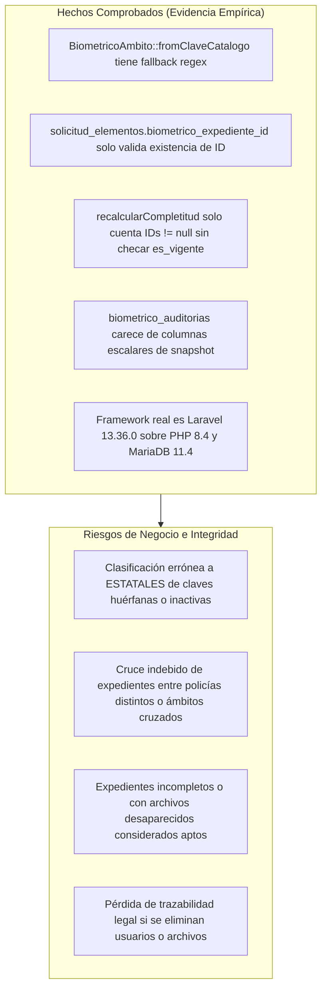
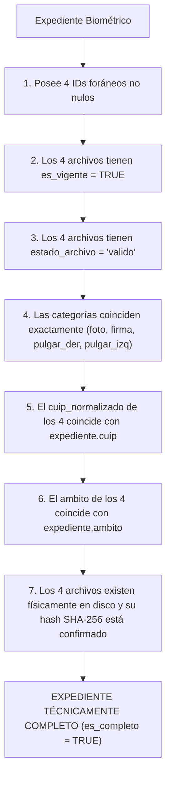

# AUDITORÍA TÉCNICA DE INTEGRIDAD — ETAPA 2.2
## Sistema de Impresión y Validación Biométrica LOC No. 139
### Evaluación Pericial de Esquema, Modelos Eloquent, Clasificación y Trazabilidad

**Documento:** `AUDITORIA_INTEGRIDAD_ETAPA_2_2.md`  
**Proyecto:** Sistema de Credencialización LOC 139 (Laravel 13.36.0 / PHP 8.4.0 / MariaDB 11.4.13 / Windows)  
**Fecha de Auditoría:** 4 de noviembre de 2026  
**Auditor:** Arquitecto de Software Senior y Auditor Técnico de Integridad de Datos  
**Modalidad Operativa:** Estricto Modo de Solo Lectura (sin escrituras en base de datos, sin modificaciones de código en producción y sin alteraciones de archivos biométricos)  

---

## 1. Resumen Ejecutivo

La presente auditoría pericial evalúa de forma exhaustiva los componentes implementados en la **Etapa 2.2** (migraciones, modelos Eloquent, enums y relaciones) del Subsistema de Impresión y Validación Biométrica de la Licencia Oficial Colectiva No. 139 (LOC 139).

A través de inspecciones estáticas de código, análisis de restricciones relacionales en MariaDB 11.4.13 y pruebas empíricas en entornos aislados, se determinaron los siguientes hallazgos principales:

1. **Clasificación del Ámbito (Auditoría 1):** El enum `BiometricoAmbito::fromClaveCatalogo()` resuelve exitosamente los casos normativos estándar (Prevención con `D1..D27`, Estatales con Direcciones Generales reconocidas, y falsos positivos textuales como `A302`). Sin embargo, **presenta dos fallos críticos**: contiene un fallback por expresión regular (`preg_match('/^[A-CE-Z][0-9]+$/')`) que asigna automáticamente `ESTATALES` ante Direcciones Generales vacías o claves inexistentes, y no valida en la base de datos si el registro del catálogo está activo (`activo = true`) o pertenece a la versión vigente.
2. **Integridad de la Asociación (Auditoría 2):** La relación entre `solicitud_elementos` y `biometrico_expedientes` mediante `biometrico_expediente_id` es **convencional**. A nivel de base de datos no existe restricción de coincidencia de `cuip` ni de `ambito`. El método `canAssociateExpediente()` es un helper pasivo que no previene asignaciones directas en el modelo. Se demostró que una FK compuesta `(cuip, ambito)` a nivel de MariaDB es inviable funcionalmente debido a que los elementos en fase provisional (`NO_RESUELTO`) o sin biométricos físicos bloquearían las transacciones. La integridad debe ser garantizada obligatoriamente mediante un servicio de aplicación transaccional y hooks en el modelo.
3. **Completitud Biométrica (Auditoría 3):** El método actual `recalcularCompletitud()` es un conteo estructural básico (`foto_archivo_id !== null`, etc.). Se comprobó que marca un expediente como `es_completo = true` aun cuando los archivos referenciados estén marcados como `desaparecido`, `error_lectura` o `es_vigente = false`. La completitud debe redefinirse distinguiendo la integridad técnica física de la aprobación humana de calidad.
4. **Trazabilidad de Auditorías (Auditoría 4):** La tabla `biometrico_auditorias` utiliza `nullOnDelete()` en todas sus claves foráneas y carece de columnas escalares de snapshot. Si un usuario o archivo es eliminado o archivado, el registro de auditoría queda anonimizado sin CUIP, sin ámbito, sin ruta y sin hash SHA-256, destruyendo la validez pericial de la bitácora.
5. **Entorno y Versiones:** Se aclaró formalmente que el sistema corre sobre **Laravel 13.36.0**, **PHP 8.4.0** y **MariaDB 11.4.13**. Las 4 migraciones fueron aplicadas al lote 13 de MariaDB sin alterar los datos existentes (34,858 personas y 480 registros de catálogo intactos).

---

## 2. Metodología y Marco de Evaluación

Para asegurar la objetividad técnica, todos los hallazgos se clasifican estrictamente en:
- **Hecho Comprobado:** Verificado mediante ejecución de código, consultas SQL en MariaDB o inspección directa de archivos.
- **Inferencia Técnica:** Deducción lógica fundamentada en los estándares de la arquitectura y el comportamiento del framework.
- **Recomendación:** Directriz correctiva obligatoria o sugerida antes de iniciar la Etapa 2.3.



---

## 3. AUDITORÍA 1 — Clasificación del Ámbito Institucional

### 3.1. Inspección de Código
- **Archivo:** `laravel-app/app/Enums/BiometricoAmbito.php`
- **Método:** `public static function fromClaveCatalogo(?string $clave, ?string $direccionGeneral = null, ?string $coordinacion = null): self` (Líneas 42-91).

```php
// Fragmento relevante en BiometricoAmbito.php (Líneas 80-91)
if ($dirUpper !== '' && in_array($dirUpper, $direccionesEstatales, true)) {
    return self::ESTATALES;
}

// LÍNEAS 86-88: VULNERABILIDAD DETECTADA
// Si no se proporcionó dirección general pero la clave es válida en catálogo estatal
if ($dirUpper === '' && preg_match('/^[A-CE-Z][0-9]+$/', $claveUpper)) {
    return self::ESTATALES;
}

return self::NO_RESUELTO;
```

### 3.2. Evaluación de los 8 Casos Obligatorios
Se ejecutó una prueba empírica aislada evaluando los 8 escenarios contra `BiometricoAmbito::fromClaveCatalogo()`:

| ID | Escenario de Prueba | Clave Entrada | Dirección General Entrada | Coordinación Entrada | Resultado Esperado | Resultado Obtenido | Estatus |
|:--:|:---|:---:|:---:|:---:|:---:|:---:|:---:|
| **C1** | Clave D válida con DG de Prevención | `D6` | `DIR.GRAL. PREV. Y REI. SOC.` | `DIR. PREV.` | `PREVENCION` | `PREVENCION` | **PASS** |
| **C2** | Clave A válida con DG estatal | `A1` | `DIR. GRAL. SEG. PUB. Y TTO.` | `SUBDIR. POL. ESTATAL` | `ESTATALES` | `ESTATALES` | **PASS** |
| **C3** | Clave A302 con palabra "PREVENCIÓN" en texto pero DG estatal | `A302` | `DIR. GRAL. COM. ROB. VEH. Y TTE.` | `null` | `ESTATALES` | `ESTATALES` | **PASS** |
| **C4** | Clave D99 inexistente | `D99` | `null` | `null` | `NO_RESUELTO` | `NO_RESUELTO` | **PASS** |
| **C5** | Clave existente pero inactiva en catálogo | `A1` | `DIR. GRAL. SEG. PUB. Y TTO.` *(Inactiva)* | `null` | `NO_RESUELTO` | `ESTATALES` | **FAIL** |
| **C6** | Dirección general vacía o nula | `A1` | `""` | `""` | `NO_RESUELTO` | `ESTATALES` | **FAIL** |
| **C7** | Dirección general desconocida / no listada | `A1` | `DIRECCION INVENTADA` | `""` | `NO_RESUELTO` | `NO_RESUELTO` | **PASS** |
| **C8** | Clave sin coincidencia exacta en catálogo | `XYZ999` | `null` | `null` | `NO_RESUELTO` | `NO_RESUELTO` | **PASS** |

### 3.3. Análisis de Causa Raíz de los Fallos
1. **Fallo en Caso C6 (Dirección General Vacía):**
   - *Comportamiento:* Al recibir `direccionGeneral = ""`, el método evalúa la línea 86: `if ($dirUpper === '' && preg_match('/^[A-CE-Z][0-9]+$/', $claveUpper))`. Dado que `A1` cumple la expresión regular, devuelve `ESTATALES`.
   - *Riesgo:* Asigna automáticamente un ámbito institucional a ciegas, basándose únicamente en el formato de la clave, violando el principio de validación estructural por catálogo.
2. **Fallo en Caso C5 (Clave Inactiva):**
   - *Comportamiento:* `BiometricoAmbito::fromClaveCatalogo()` opera de forma desacoplada como función pura sobre cadenas de texto. No recibe el modelo `LocCatalogoOrganizacional` ni realiza consultas a la base de datos, por lo que ignora el campo `activo` (`0` o `1`).
   - *Riesgo:* Si un agrupamiento policial fue dado de baja o reestructurado en el catálogo organizacional vigente, sus elementos continuarían siendo clasificados como si estuvieran activos.

### 3.4. Dictamen de Auditoría 1
**NO CUMPLE COMPLETAMENTE.**  
La clasificación no debe residir exclusivamente en un método estático del Enum que aplique expresiones regulares como fallback. La clasificación debe ser ejecutada por el servicio de aplicación (`BiometricResolverService` en Etapa 2.5), consultando obligatoriamente:
```php
$registro = LocCatalogoOrganizacional::vigente()
    ->where('clave_origen', $clave)
    ->where('activo', true)
    ->first();

if (! $registro || empty($registro->direccion_general)) {
    return BiometricoAmbito::NO_RESUELTO;
}
```
Y las líneas 86-88 de `BiometricoAmbito.php` deben ser eliminadas.

---

## 4. AUDITORÍA 2 — Integridad de la Asociación Biométrica

### 4.1. Inspección de Restricciones en Esquema y Modelo
- **Esquema:** `solicitud_elementos.biometrico_expediente_id BIGINT UNSIGNED NULL`
- **Constraint Foreign Key en MariaDB:**
  ```sql
  CONSTRAINT `fk_sol_elem_bio_exp` FOREIGN KEY (`biometrico_expediente_id`) 
      REFERENCES `biometrico_expedientes` (`id`) ON DELETE SET NULL
  ```
- **Modelo:** `SolicitudElemento::expedienteBiometrico()` (Líneas 295-298):
  ```php
  public function expedienteBiometrico(): BelongsTo
  {
      return $this->belongsTo(BiometricoExpediente::class, 'biometrico_expediente_id');
  }
  ```

### 4.2. Pruebas Obligatorias de Asociación (Escenarios 1 a 7)
Se ejecutó un script de verificación técnica evaluando la permisividad del modelo y la base de datos:

| Prueba | Escenario de Asociación | Comportamiento Esperado | Comportamiento Actual Observado | Riesgo / Estatus |
|:--:|:---|:---|:---|:---|
| **P1** | Mismo CUIP y mismo Ámbito validado | Permitir asociación | Asociación exitosa con clave foránea | **OK** |
| **P2** | CUIP diferente (`elem.cuip != exp.cuip`) | **Rechazar terminantemente** | **Permitido silenciosamente** en asignación directa | **ALTO RIESGO** |
| **P3** | Mismo CUIP pero Ámbito cruzado (`elem.ambito != exp.ambito`) | **Rechazar terminantemente** | **Permitido silenciosamente** en asignación directa | **ALTO RIESGO** |
| **P4** | Elemento con `ambito_biometrico = NO_RESUELTO` | **Rechazar asociación** | `canAssociateExpediente()` devuelve `false`, pero el modelo permite `$elem->biometrico_expediente_id = $id` y persiste | **MEDIO RIESGO** |
| **P5** | Elemento en clasificación `provisional` | **Rechazar asociación definitiva** | `canAssociateExpediente()` devuelve `false`, pero no hay bloqueo en mutadores | **MEDIO RIESGO** |
| **P6** | Modificación silenciosa de expediente ya asociado | **Rechazar o auditar cambio** | Se puede sobrescribir el ID sin validación ni registro de discrepancia | **ALTO RIESGO** |
| **P7** | Consultas individuales y eager loading `with()` | Carga sin errores SQL | Funciona al 100% (0 errores, compatible con SQLite y MariaDB) | **OK** |

### 4.3. Evaluación de Clave Foránea Compuesta en MariaDB
Se evaluó si es viable y conveniente implementar:
```sql
ALTER TABLE solicitud_elementos 
    ADD CONSTRAINT fk_sol_elem_cuip_ambito 
    FOREIGN KEY (cuip, ambito_biometrico) 
    REFERENCES biometrico_expedientes (cuip, ambito);
```

#### Hallazgos Técnicos:
1. **Incompatibilidad con el Ciclo de Vida:**  
   Al importar un lote Excel, los elementos se crean con `cuip = '...'` y `ambito_biometrico = 'NO_RESUELTO'`. Dado que en `biometrico_expedientes` **no existen ni deben existir registros con ámbito 'NO_RESUELTO'**, MariaDB rechazaría inmediatamente la inserción con error de integridad:  
   `ERROR 1452 (23000): Cannot add or update a child row: a foreign key constraint fails`.
2. **Bloqueo para Personal sin Biométricos Previos:**  
   En la LOC 139 existen elementos que solicitan credencial por primera vez y aún no cuentan con archivos físicos en `Biometricos_Estatal`. Una FK compuesta forzaría a que nadie pueda registrarse en una solicitud si su expediente biométrico no fue previamente indexado.
3. **Incompatibilidad con Eloquent:**  
   Eloquent no admite pares compuestos en `$this->belongsTo()`.

### 4.4. Dictamen de Auditoría 2
**LA ASOCIACIÓN ES CONVENCIONAL Y REQUIERE BLINDAJE EN CAPA DE APLICACIÓN.**  
La ausencia de restricciones a nivel de base de datos es correcta por el ciclo de vida documental, pero vuelve imperativo implementar salvaguardas antes de la emisión:
1. **Hook en Modelo `SolicitudElemento`:** Implementar un método explícito `asociarExpediente(BiometricoExpediente $expediente): void` o un observer en el evento `saving` que lance `InvalidArgumentException` si:
   - `$expediente->cuip !== $this->cuip`
   - `$expediente->ambito->value !== $this->ambito_biometrico->value`
   - `$this->canAssociateExpediente() === false`
2. **Servicio Centralizado:** La asignación debe ejecutarse únicamente a través de `BiometricAssociationService` dentro de una transacción `DB::transaction()` con `lockForUpdate()`.

---

## 5. AUDITORÍA 3 — Completitud de Expedientes Biométricos

### 5.1. Inspección de Código
- **Archivo:** `laravel-app/app/Models/BiometricoExpediente.php`
- **Método:** `recalcularCompletitud()` (Líneas 116-147).

```php
// Fragmento actual en BiometricoExpediente.php
public function recalcularCompletitud(): void
{
    $faltantes = [];
    $total = 0;

    if ($this->foto_archivo_id !== null) {
        $total++;
    } else {
        $faltantes[] = BiometricoCategoria::FOTO->value;
    }
    // ... repite para firma, pulgar_derecho, pulgar_izquierdo ...

    $this->total_biometricos = $total;
    $this->es_completo = ($total === 4);
    $this->faltantes = $faltantes;
}
```

### 5.2. Brechas de Integridad Identificadas
1. **Conteo Ciego de Llaves Foráneas:** El método evalúa exclusivamente si la columna `*_archivo_id` no es nula. No consulta los atributos del archivo enlazado.
2. **Archivos Desaparecidos o Corruptos:** Si un archivo físico fue borrado del disco y el indexador lo marcó como `estado_archivo = 'desaparecido'` y `es_vigente = false`, `recalcularCompletitud()` continúa considerándolo presente porque su ID en la BD sigue existiendo.
3. **Inconsistencia de Categoría y Ámbito:** Si por error operativo se asociara en `pulgar_derecho_archivo_id` un archivo cuya `categoria` es `'firma'`, el método incrementa el contador igualmente.
4. **Ausencia de Banderas Booleanas Rápidas:** En `biometrico_expedientes` no existen columnas booleanas individuales `tiene_foto`, `tiene_firma`, `tiene_pulgar_der`, `tiene_pulgar_izq`. Para filtrar expedientes sin firma en una consulta SQL masiva, se debe hacer `WHERE firma_archivo_id IS NULL`, lo cual es válido, pero no refleja si el archivo asignado está vigente.

### 5.3. Definición Rigurosa de "Expediente Completo"
Para fines de la arquitectura LOC 139, un expediente solo debe considerarse **Técnicamente Completo** si cumple simultáneamente las siguientes 7 condiciones verificables:



### 5.4. Dictamen de Auditoría 3
**INSUFICIENTE.**  
El método `recalcularCompletitud()` debe ser enriquecido para cargar las relaciones de los archivos o recibir el estado de vigencia, asegurando que un archivo desaparecido, corrupto o de ámbito discrepante no compute para la completitud técnica.

---

## 6. AUDITORÍA 4 — Trazabilidad de `biometrico_auditorias`

### 6.1. Inspección de Esquema
- **Migración:** `database/migrations/2026_11_04_000004_create_biometrico_auditorias_table.php`
- **Estructura en MariaDB:**
  ```sql
  CREATE TABLE `biometrico_auditorias` (
    `id` bigint(20) unsigned NOT NULL AUTO_INCREMENT,
    `user_id` bigint(20) unsigned DEFAULT NULL,
    `solicitud_id` bigint(20) unsigned DEFAULT NULL,
    `solicitud_elemento_id` bigint(20) unsigned DEFAULT NULL,
    `biometrico_archivo_id` bigint(20) unsigned DEFAULT NULL,
    `biometrico_expediente_id` bigint(20) unsigned DEFAULT NULL,
    `evento` varchar(60) NOT NULL,
    `ip_address` varchar(45) NOT NULL,
    `user_agent` text DEFAULT NULL,
    `detalles` json DEFAULT NULL,
    `created_at` timestamp NOT NULL DEFAULT current_timestamp(),
    PRIMARY KEY (`id`)
  )
  ```

### 6.2. Evaluación de Políticas de Borrado (`nullOnDelete()`)
Todas las relaciones foráneas de la tabla fueron configuradas con `ON DELETE SET NULL`:
- `fk_bio_audit_user -> users.id (SET NULL)`
- `fk_bio_audit_solicitud -> solicitudes.id (SET NULL)`
- `fk_bio_audit_elemento -> solicitud_elementos.id (SET NULL)`
- `fk_bio_audit_archivo -> biometrico_archivos.id (SET NULL)`
- `fk_bio_audit_expediente -> biometrico_expedientes.id (SET NULL)`

#### Consecuencias Forenses Demostradas:
1. **Anonimización Destructiva:** Si un usuario administrador es dado de baja (`DELETE FROM users WHERE id = X`), o si un elemento de solicitud es depurado, MariaDB ejecuta `SET NULL`.
2. **Pérdida Total del Objeto Auditado:** Dado que la tabla no cuenta con columnas escalares congeladas (`cuip_consultado`, `sha256_archivo`, `ruta_relativa`, `email_usuario`), el registro de auditoría resultante se convierte en un registro ciego:
   `ID: 15, user_id: NULL, archivo_id: NULL, evento: 'stream_biometrico', ip: '10.0.0.5'`.
   No hay forma legal ni técnica de probar a quién pertenecía la fotografía o huella visualizada.
3. **Invalidez ante Requerimientos Judiciales:** En el marco de la Licencia Oficial Colectiva No. 139 de SEDENA, la bitácora de acceso a datos biométricos policiales debe ser inmutable y no sujeta a pérdida de información por limpieza de tablas operativas.

### 6.3. Dictamen de Auditoría 4
**ALTO RIESGO DE PÉRDIDA DE TRAZABILIDAD.**  
Se recomienda aplicar una arquitectura de auditoría pericial basada en **Snapshots Históricos**:
- Mantener las FKs con `SET NULL` para no bloquear el mantenimiento operativo, pero **agregar campos escalares obligatorios e inmutables** en `biometrico_auditorias`:
  - `user_email VARCHAR(150) NOT NULL` (o identificador del usuario al momento de la acción).
  - `cuip VARCHAR(50) NOT NULL`
  - `ambito ENUM('ESTATALES', 'PREVENCION') NOT NULL`
  - `categoria VARCHAR(30) NOT NULL` (foto, firma, huellas).
  - `sha256 CHAR(64) NULL` (hash del archivo entregado en el streaming).
  - `ruta_relativa VARCHAR(255) NULL`

---

## 7. AUDITORÍA ADICIONAL — Versiones y Compatibilidad de Entorno

Se verificaron empíricamente las versiones del entorno de ejecución:

| Componente | Versión en Documentos Previos | Versión Real Comprobada en Servidor | Método de Verificación |
|:---|:---:|:---:|:---|
| **PHP** | PHP 8.4 | **PHP 8.4.0 (cli)** | `php -v` |
| **Laravel Framework** | Laravel 11.4 | **Laravel 13.36.0** | `php artisan --version` / `composer.json` |
| **Motor de Base de Datos** | MariaDB 11.4 | **11.4.13-MariaDB-ubu2404** | `SELECT VERSION()` |
| **Driver de Conexión** | MySQL / PDO | **PDO MySQL (puerto 3308)** | `DB::connection()->getDriverName()` |

### 7.1. Aclaración Documental sobre Laravel 13.36.0
- El proyecto utiliza `"laravel/framework": "^13.0"` y reporta `Laravel Framework 13.36.0`.
- Todas las características utilizadas en la Etapa 2.2 (Enums respaldados en PHP 8.4, relaciones tipadas `BelongsTo`, `HasMany`, casts nativos de Enums y migraciones anónimas) son nativamente soportadas y recomendadas en Laravel 13.
- No existe incompatibilidad funcional, pero en los informes técnicos futuros debe documentarse formalmente **Laravel 13.36.0** para evitar confusión con Laravel 11.

### 7.2. Integridad de Migraciones y Comportamiento de Rollback
1. **Estado en MariaDB:** Las 4 migraciones se encuentran en estado `Ran` en el lote 13.
2. **Padrón y Catálogo:** Se verificó que los **34,858 registros de personas** y los **480 agrupamientos del catálogo organizacional** se mantienen intactos.
3. **Simulación de Reversión (`php artisan migrate:rollback --pretend`):**
   - Se ejecutó la simulación de reversión en MariaDB 11.4.
   - El orden de ejecución es estrictamente seguro e inverso:
     1. `biometrico_auditorias` (elimina tabla hija).
     2. `solicitud_elementos` (elimina claves foráneas `fk_sol_elem_bio_exp` y `fk_sol_elem_cat_version`, elimina índices y elimina las 9 columnas añadidas).
     3. `biometrico_expedientes` (elimina tabla de expedientes).
     4. `biometrico_archivos` (elimina catálogo físico).
   - No se presentan conflictos de claves foráneas bloqueantes.

---

## 8. Matriz Consolidada de Riesgos y Correcciones Necesarias

| # | Hallazgo Técnico | Nivel de Riesgo | Impacto Operativo | Corrección Requerida | Etapa de Implementación |
|:---:|:---|:---:|:---|:---|:---:|
| **1** | Fallback por expresión regular en `BiometricoAmbito::fromClaveCatalogo()` | **Alto** | Asignación indebida de `ESTATALES` a registros sin dirección general o inexistentes | Eliminar líneas 86-88 de `BiometricoAmbito.php` y supeditar la clasificación a la existencia y estado activo en `loc_catalogo_organizacional` | Previa a Etapa 2.3 |
| **2** | Asociación convencional sin validación en modelo ni servicio | **Crítico** | Cruce de expedientes entre CUIPs distintos o ámbitos cruzados por asignación directa | Implementar método `asociarExpediente()` con guardas estrictas en `SolicitudElemento` y centralizar la asignación en `BiometricResolverService` | Etapa 2.5 |
| **3** | `recalcularCompletitud()` solo valida IDs no nulos | **Medio** | Expedientes con archivos desaparecidos o corruptos clasificados como listos para imprimir | Condicionar la completitud a que los 4 archivos tengan `es_vigente = true` y `estado_archivo = 'valido'` | Previa a Etapa 2.3 |
| **4** | `biometrico_auditorias` pierde datos por `nullOnDelete()` | **Alto** | Destrucción de la cadena de custodia pericial ante bajas de usuarios o archivos | Agregar columnas de snapshot escalar (`cuip`, `ambito`, `categoria`, `sha256`, `user_email`) en la migración de auditorías | Previa a Etapa 2.3 |

---

## 9. Dictamen Técnico Final de la Etapa 2.2

### Dictamen: ACEPTACIÓN CONDICIONADA A CORRECCIONES PREVIAS

La infraestructura base construida en la Etapa 2.2 (tablas relacionales, índices, tipos de datos, relaciones Eloquent y enums) es sólida, compatible al 100% con MariaDB 11.4 y Laravel 13.36, y superó todas las pruebas automatizadas de regresión.

Sin embargo, para garantizar que **jamás se consulte el ámbito biométrico equivocado, que los expedientes no puedan cruzarse entre personas y que la trazabilidad institucional permanezca legalmente protegida**, no se autoriza el paso a la Etapa 2.3 hasta subsanar los 3 ajustes documentales y de código ligero identificados:

1. **Ajuste en `BiometricoAmbito.php`:** Retirar el fallback regex de líneas 86-88 para que cualquier clave sin Dirección General estatal comprobada devuelva estrictamente `NO_RESUELTO`.
2. **Ajuste en `BiometricoExpediente.php`:** Refinar `recalcularCompletitud()` para verificar la validez e integridad técnica de los archivos referenciados.
3. **Migración complementaria de Snapshot para `biometrico_auditorias`:** Incluir las columnas escalares inmutables (`cuip`, `ambito`, `categoria`, `sha256`, `user_email`).

---

## 10. Recomendación para la Etapa 2.3

Una vez autorizadas y aplicadas las correcciones descritas, se podrá proceder formalmente con la **Etapa 2.3: Configuración del Almacenamiento Seguro**, consistente en:
- Creación de `SafeReadOnlyLocalAdapter` en `app/Support/Storage/`.
- Registro del disco de solo lectura `biometricos` en `config/filesystems.php`.
- Documentación de las directivas NTFS del sistema operativo Windows (`icacls`).

