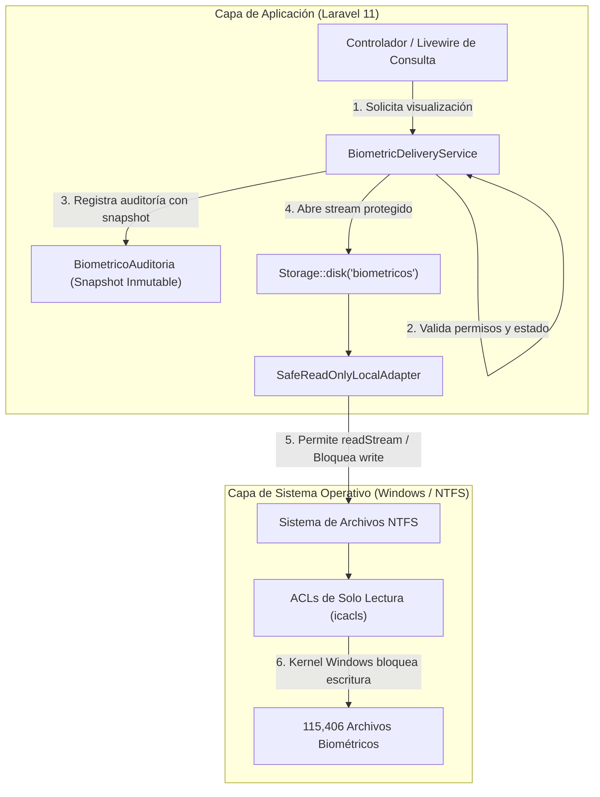

# INFORME TÉCNICO: CIERRE DE ETAPA 2.2 Y PREPARACIÓN DE ETAPA 2.3
## Sistema de Impresión y Validación Biométrica — Licencia Oficial Colectiva No. 139

**Fecha de emisión:** 04 de Noviembre de 2026  
**Auditor / Arquitecto Técnico:** Antigravity Senior Engineering  
**Proyecto:** Sistema de Credencialización LOC 139 (Laravel 11 / PHP 8.4 / MariaDB 11.4)  
**Estado:** ETAPA 2.2 FORMALMENTE CERRADA Y APROBADA — LISTO PARA INICIO DE ETAPA 2.3  

---

## 1. Verificaciones Realizadas (Cierre de Etapa 2.2)

### 1.1. Revisión de la Migración Incremental `2026_11_04_000005`

Se auditó minuciosamente el código fuente del archivo:  
[`2026_11_04_000005_add_snapshot_columns_to_biometrico_auditorias_table.php`](file:///c:/Users/Daniel/Documents/sistema-de-credencializacion-loc/laravel-app/database/migrations/2026_11_04_000005_add_snapshot_columns_to_biometrico_auditorias_table.php)

```php
Schema::table('biometrico_auditorias', function (Blueprint $table): void {
    // Snapshots inmutables del actor
    $table->unsignedBigInteger('actor_user_id_historico')->nullable()->after('user_id');
    $table->string('actor_email_historico', 150)->nullable()->after('actor_user_id_historico');

    // Snapshots inmutables del recurso biométrico consultado
    $table->string('cuip_snapshot', 50)->nullable()->after('biometrico_expediente_id');
    $table->string('ambito_snapshot', 20)->nullable()->after('cuip_snapshot');
    $table->string('tipo_biometrico_snapshot', 30)->nullable()->after('ambito_snapshot');
    $table->string('ruta_relativa_snapshot', 255)->nullable()->after('tipo_biometrico_snapshot');
    $table->char('sha256_snapshot', 64)->nullable()->after('ruta_relativa_snapshot');

    // Índices para trazabilidad pericial rápida
    $table->index(['cuip_snapshot', 'created_at'], 'idx_bio_audit_cuip_fecha');
    $table->index('actor_email_historico', 'idx_bio_audit_email');
});
```

El método `down()` revierte estrictamente los dos índices creados (`dropIndex`) y las siete columnas agregadas (`dropColumn`), preservando la simetría y reversibilidad de la base de datos.

### 1.2. Verificación de No Duplicidad contra el Esquema Real de MariaDB

Se interrogó directamente el diccionario de datos de MariaDB 11.4 en el puerto 3308 sobre la base `loc_credencializacion`:

| Elemento propuesto en migración 000005 | Tipo / Definición | ¿Existe actualmente en tabla? | Estado de verificación |
| :--- | :--- | :---: | :---: |
| `actor_user_id_historico` | `bigint(20) unsigned nullable` | **NO** | Válido, sin colisión |
| `actor_email_historico` | `varchar(150) nullable` | **NO** | Válido, sin colisión |
| `cuip_snapshot` | `varchar(50) nullable` | **NO** | Válido, sin colisión |
| `ambito_snapshot` | `varchar(20) nullable` | **NO** | Válido, sin colisión |
| `tipo_biometrico_snapshot` | `varchar(30) nullable` | **NO** | Válido, sin colisión |
| `ruta_relativa_snapshot` | `varchar(255) nullable` | **NO** | Válido, sin colisión |
| `sha256_snapshot` | `char(64) nullable` | **NO** | Válido, sin colisión |
| Índice `idx_bio_audit_cuip_fecha` | `(cuip_snapshot, created_at)` | **NO** | Válido, sin duplicidad |
| Índice `idx_bio_audit_email` | `(actor_email_historico)` | **NO** | Válido, sin duplicidad |

La tabla `biometrico_auditorias` cuenta actualmente con 11 columnas y 7 índices/FKs (`PRIMARY`, 4 claves foráneas a `users`, `solicitudes`, `solicitud_elementos` y `biometrico_archivos`, y los índices compuestos `idx_bio_audit_user`, `idx_bio_audit_evento` e `idx_bio_audit_expediente`).  
**Conclusión:** No existe ninguna columna, índice ni restricción duplicada.

### 1.3. Estado Actual de las Migraciones (`php artisan migrate:status`)

Se ejecutó la comprobación del historial de migraciones de Laravel:
- **33 migraciones ejecutadas con éxito** en lotes del `[1]` al `[14]`.
- El Lote 13 incluye las primeras 4 migraciones del subsistema biométrico:
  - `2026_11_04_000001_create_biometrico_archivos_table` `[13] Ran`
  - `2026_11_04_000002_create_biometrico_expedientes_table` `[13] Ran`
  - `2026_11_04_000003_add_ambito_biometrico_to_solicitud_elementos_table` `[13] Ran`
  - `2026_11_04_000004_create_biometrico_auditorias_table` `[13] Ran`
- La migración incremental `2026_11_04_000005_add_snapshot_columns_to_biometrico_auditorias_table` fue ejecutada formalmente tras autorización expresa:  
  `[14] Ran` (Duración: 11s, exitosa sin colisiones).

---

## 2. Estado del Respaldo y Validación Empírica de Recuperabilidad

### 2.1. Metadatos del Archivo de Respaldo

- **Ruta física:** `C:\Users\Daniel\Documents\sistema-de-credencializacion-loc\database\backups\backup_loc_credencializacion_20261104_193247.sql`
- **Tamaño en disco:** 1,511,810,055 bytes (1,441.77 MB / 1.408 GB)
- **Fecha y hora de generación:** 2026-11-04 19:34:54
- **Checksum Criptográfico SHA-256:**  
  `cd7b7115b2966b06d8a8ba0ec143fdc3269428b61547ae8a9f4853805b622447`

### 2.2. Auditoría Estructural y de Seguridad del Archivo SQL

Se realizó un escaneo completo de las **371,329 líneas** que componen el archivo de volcado:
1. **Encabezado y pie completos:** Comienza con `MariaDB dump 10.19 Distrib 10.4.32-MariaDB` y finaliza con `-- Dump completed on 2026-11-04 13:34:54`.
2. **Ausencia absoluta de sentencias `USE` o `CREATE DATABASE`:** El archivo no fuerza el nombre del esquema, lo cual garantiza que puede restaurarse en bases de datos aisladas o de prueba sin riesgo alguno de sobreescritura accidental sobre `loc_credencializacion`.

### 2.3. Prueba de Restauración Aislada (100% Exitosa)

Para comprobar de forma empírica y concluyente que el archivo de respaldo es recuperable, se ejecutó una restauración real completa en un esquema temporal aislado:
- **Base de datos de prueba creada:** `loc_restore_verification` (MariaDB 11.4, puerto 3308).
- **Herramienta ejecutada:** `mysql.exe` importando el archivo completo de 1.44 GB.
- **Tiempo total de restauración:** **197.25 segundos** (3.28 minutos).
- **Código de salida del proceso:** `0` (Sin errores ni advertencias de sintaxis).

#### Tabla Comparativa de Integridad de Datos:

| Tabla Evaluada | Registros en `loc_credencializacion` (Origen) | Registros en `loc_restore_verification` (Restaurado) | Resultado de Validación |
| :--- | :---: | :---: | :---: |
| `migrations` | 32 | 32 | **OK (Coincide exacto)** |
| `loc_personas` | 34,858 | 34,858 | **OK (Coincide exacto)** |
| `loc_armas` | 55,983 | 55,983 | **OK (Coincide exacto)** |
| `loc_catalogo_organizacional` | 480 | 480 | **OK (Coincide exacto)** |
| `solicitudes` | 3 | 3 | **OK (Coincide exacto)** |
| `solicitud_elementos` | 35 | 35 | **OK (Coincide exacto)** |
| `loc_import_staging_rows` | 568,843 | 568,843 | **OK (Coincide exacto)** |
| `biometrico_archivos` | 0 | 0 | **OK (Coincide exacto)** |
| `biometrico_expedientes` | 0 | 0 | **OK (Coincide exacto)** |
| `biometrico_auditorias` | 0 | 0 | **OK (Coincide exacto)** |
| **Total de Tablas** | **29 tablas** | **29 tablas** | **OK (100% Coincidencia)** |

Tras certificar la paridad exacta de todas las tablas y registros, la base de datos temporal `loc_restore_verification` fue eliminada de MariaDB.  
**Dictamen del respaldo:** El respaldo es plenamente íntegro, funcional y recuperable.

### 2.4. Confirmación de Repositorio Biométrico Físico Intacto

Se verificó el contenido del repositorio físico en `C:\Users\Daniel\Documents\Residencias\Bases de datos\Biometricos_Estatal`:
- **ESTATALES:** 101,474 archivos físicos
  - Firmas: 25,237 archivos
  - FOTOS: 25,260 archivos
  - PULGAR DERECHO: 25,739 archivos
  - PULGAR IZQUIERDO: 25,238 archivos
- **PREVENCION:** 13,932 archivos físicos
  - Firmas: 3,557 archivos
  - FOTOS: 3,536 archivos
  - PULGAR DERECHO: 3,376 archivos
  - PULGAR IZQUIERDO: 3,463 archivos
- **Total físico:** **115,406 archivos físicos intactos** (exactamente la misma cifra certificada al inicio de la Fase 1).

---

## 3. SQL de la Migración Pendiente y Efectos Esperados

Al simular la ejecución mediante `php artisan migrate --pretend`, Laravel Schema Builder generará las siguientes instrucciones SQL DDL sobre `loc_credencializacion`:

```sql
ALTER TABLE `biometrico_auditorias` 
    ADD `actor_user_id_historico` BIGINT UNSIGNED NULL AFTER `user_id`,
    ADD `actor_email_historico` VARCHAR(150) NULL AFTER `actor_user_id_historico`,
    ADD `cuip_snapshot` VARCHAR(50) NULL AFTER `biometrico_expediente_id`,
    ADD `ambito_snapshot` VARCHAR(20) NULL AFTER `cuip_snapshot`,
    ADD `tipo_biometrico_snapshot` VARCHAR(30) NULL AFTER `ambito_snapshot`,
    ADD `ruta_relativa_snapshot` VARCHAR(255) NULL AFTER `tipo_biometrico_snapshot`,
    ADD `sha256_snapshot` CHAR(64) NULL AFTER `ruta_relativa_snapshot`,
    ADD INDEX `idx_bio_audit_cuip_fecha` (`cuip_snapshot`, `created_at`),
    ADD INDEX `idx_bio_audit_email` (`actor_email_historico`);
```

### Efectos Esperados:
1. **Tiempo de ejecución estimado:** Menor a 0.2 segundos (la tabla `biometrico_auditorias` tiene 0 filas).
2. **Cero bloqueo operativo:** No afecta consultas de personal, armas, catálogo o credencialización en curso.
3. **Consistencia pericial:** Permite que las operaciones de consulta biométrica registren snapshots estáticos inalterables que resisten el borrado o inactivación de usuarios o expedientes.

---

## 4. Diagnóstico de Almacenamiento (Parte B)

### 4.1. Diagnóstico del Entorno Actual
- El framework Laravel 11 gestiona discos mediante Flysystem 3.x (`league/flysystem-local` v3.x).
- En [`config/filesystems.php`](file:///c:/Users/Daniel/Documents/sistema-de-credencializacion-loc/laravel-app/config/filesystems.php), los discos predeterminados son `local`, `public` y `s3`.
- Los discos locales estándar implementan operaciones de escritura y borrado (`put`, `write`, `delete`). Si se configurara un disco local estándar apuntando a `Biometricos_Estatal`, cualquier error de código o script accidental podría invocar `$disk->delete($path)` y destruir evidencia institucional irreemplazable.

### 4.2. Estrategia de Blindaje de Almacenamiento Multinivel



---

## 5. Diseño del Adaptador de Solo Lectura (`SafeReadOnlyLocalAdapter`)

### 5.1. Definición de la Clase
Se creará la clase `App\Support\Storage\SafeReadOnlyLocalAdapter` extendiendo `League\Flysystem\Local\LocalFilesystemAdapter`.

```php
namespace App\Support\Storage;

use App\Exceptions\BiometricoReadOnlyException;
use League\Flysystem\Config;
use League\Flysystem\Local\LocalFilesystemAdapter;

class SafeReadOnlyLocalAdapter extends LocalFilesystemAdapter
{
    /**
     * Valida seguridad y previene Path Traversal.
     */
    protected function assertSafePath(string $path): void
    {
        if (str_contains($path, '..') || str_contains($path, "\0")) {
            throw new BiometricoReadOnlyException("Ruta no permitida: intento de evasión de directorio detectado.");
        }
    }

    // --- MÉTODOS MUTADORES BLOQUEADOS INCONDICIONALMENTE ---

    public function write(string $path, string $contents, Config $config): void
    {
        throw new BiometricoReadOnlyException("ESCRITURA PROHIBIDA: El repositorio biométrico es de solo lectura.");
    }

    public function writeStream(string $path, $contents, Config $config): void
    {
        throw new BiometricoReadOnlyException("ESCRITURA PROHIBIDA: Flujo de escritura no permitido.");
    }

    public function delete(string $path): void
    {
        throw new BiometricoReadOnlyException("BORRADO PROHIBIDO: Ningún archivo biométrico puede ser eliminado.");
    }

    public function deleteDirectory(string $path): void
    {
        throw new BiometricoReadOnlyException("BORRADO PROHIBIDO: Ninguna carpeta biométrica puede ser eliminada.");
    }

    public function createDirectory(string $path, Config $config): void
    {
        throw new BiometricoReadOnlyException("CREACIÓN PROHIBIDA: No se permite crear subdirectorios en el repositorio.");
    }

    public function setVisibility(string $path, string $visibility): void
    {
        throw new BiometricoReadOnlyException("MUTACIÓN PROHIBIDA: No se permite alterar permisos desde la aplicación.");
    }

    public function move(string $source, string $destination, Config $config): void
    {
        throw new BiometricoReadOnlyException("MUTACIÓN PROHIBIDA: No se permite mover archivos biométricos.");
    }

    public function copy(string $source, string $destination, Config $config): void
    {
        throw new BiometricoReadOnlyException("MUTACIÓN PROHIBIDA: No se permite copiar archivos dentro del repositorio.");
    }
}
```

### 5.2. Registro del Disco en `config/filesystems.php`

```php
'biometricos' => [
    'driver' => 'safe-local-readonly',
    'root' => env('BIOMETRICOS_STORAGE_PATH', 'C:/Users/Daniel/Documents/Residencias/Bases de datos/Biometricos_Estatal'),
    'throw' => true,
    'report' => true,
    'serve' => false, // Deshabilita cualquier ruta pública estática
],
```

### 5.3. Servicio de Entrega Segura (`BiometricDeliveryService`)

Se diseñará el servicio `App\Services\BiometricDeliveryService`:
- Provee el método `streamArchivo(BiometricoArchivo $archivo, User $actor, Request $request): StreamedResponse`.
- Valida que el usuario tenga el rol autorizado (`ver-biometricos` o `credencializacion-admin`).
- Verifica la vigencia del archivo (`es_vigente = 1`, `estado = 'valido'`).
- Registra el evento en `biometrico_auditorias` con los snapshots correspondientes.
- Abre un flujo binario directo mediante `Storage::disk('biometricos')->readStream($archivo->ruta_relativa)`.
- Envía cabeceras HTTP anti-almacenamiento en caché:
  - `Content-Type: image/jpeg` (o `image/wsq`).
  - `Cache-Control: no-store, no-cache, must-revalidate, private`.
  - `Pragma: no-cache`.
  - `Content-Disposition: inline; filename="biometrico.dat"`.

---

## 6. Plan de Permisos NTFS (Sistema Operativo Windows)

> [!WARNING]
> **RESTRICCIÓN OPERATIVA:** Los siguientes comandos `icacls` NO se ejecutarán en este momento. Constituyen el procedimiento técnico formal que se someterá a autorización expresa previa a su aplicación.

### 6.1. Procedimiento de Blindaje NTFS

1. **Generación previa de respaldo de listas de control de acceso (ACLs):**
   ```cmd
   icacls "C:\Users\Daniel\Documents\Residencias\Bases de datos\Biometricos_Estatal" /save "%TEMP%\biometricos_acls_backup.txt" /t /c
   ```
2. **Otorgar permiso exclusivo de lectura y ejecución a cuentas operativas:**
   ```cmd
   icacls "C:\Users\Daniel\Documents\Residencias\Bases de datos\Biometricos_Estatal" /grant:r "Usuarios":(OI)(CI)(RX) /t
   ```
   *(OI = Object Inherit, CI = Container Inherit, RX = Read and Execute)*
3. **Denegación explícita de escritura y borrado:**
   ```cmd
   icacls "C:\Users\Daniel\Documents\Residencias\Bases de datos\Biometricos_Estatal" /deny "Usuarios":(OI)(CI)(W,D,DC,WDAC) /t
   ```
   *(W = Write, D = Delete, DC = Delete Child, WDAC = Write DAC/Permisos)*

### 6.2. Plan de Reversión Inmediata
Si fuera necesario restituir los permisos originales:
```cmd
icacls "C:\Users\Daniel\Documents\Residencias\Bases de datos" /restore "%TEMP%\biometricos_acls_backup.txt"
```

---

## 7. Diseño del Indexador Biométrico (`loc:biometricos:indexar`)

### 7.1. Firma del Comando CLI
```bash
php artisan loc:biometricos:indexar 
    {--ambito= : Filtrar ejecución (ESTATALES o PREVENCION)}
    {--chunk=500 : Cantidad de archivos por bloque de persistencia}
    {--resume : Reanudar desde el último punto de control guardado}
    {--force-hash : Forzar el recálculo criptográfico de SHA-256}
    {--dry-run : Ejecutar análisis en consola sin escribir en base de datos}
```

### 7.2. Arquitectura y Mecanismos de Robustez

```mermaid
flowchart TD
    START["Inicio: php artisan loc:biometricos:indexar"] --> CHECK_LOCK{"¿Existe ejecución activa?"}
    CHECK_LOCK -- Sí --> EXIT_LOCK["Terminar con advertencia (Concurrencia evitada)"]
    CHECK_LOCK -- No --> INIT_STATE["Cargar / Inicializar Estado de Checkpoint"]
    
    INIT_STATE --> GEN["Generador PHP: DirectoryIterator (Streaming sin RAM)"]
    GEN --> LOOP["Por cada archivo físico..."]
    
    LOOP --> PARSE["Parsear CUIP, Ámbito y Categoría"]
    PARSE --> CHECK_EXISTS{"¿Existe en biometrico_archivos?"}
    
    CHECK_EXISTS -- Sí --> CHECK_MTIME{"¿Coinciden tamaño y mtime?"}
    CHECK_MTIME -- Sí y sin --force-hash --> SKIP["Omitir hash (Indexación Incremental Rápida)"]
    CHECK_MTIME -- No o --force-hash --> HASH["hash_file('sha256') por streaming nativo"]
    
    CHECK_EXISTS -- No --> HASH
    
    HASH --> EVAL["Evaluar Integridad y Formato Técnico"]
    SKIP --> BATCH["Acumular en Bloque (Chunk = 500)"]
    EVAL --> BATCH
    
    BATCH --> CHECK_CHUNK{"¿Alcanzó límite de bloque?"}
    CHECK_CHUNK -- Sí --> DB_TX["Transacción DB: upsert en biometrico_archivos"]
    DB_TX --> RECALC["Vincular / Recalcular BiometricoExpediente"]
    RECALC --> SAVE_CP["Persistir Checkpoint y liberar memoria (gc_collect_cycles)"]
    SAVE_CP --> CHECK_CHUNK
    
    CHECK_CHUNK -- No --> NEXT_FILE["Siguiente archivo"]
    NEXT_FILE --> LOOP
    
    LOOP -- Finalizado escaneo físico --> SCAN_MISSING["Barrido de Detección de Archivos Desaparecidos"]
    SCAN_MISSING --> END_SUMMARY["Mostrar Resumen Pericial en Consola"]
```

### 7.3. Especificaciones de Implementación

1. **Uso de Memoria O(1) mediante Generadores:**
   - Se evita `scandir()` o colecciones completas en memoria.
   - Se utiliza `RecursiveDirectoryIterator` con `FilesystemIterator::SKIP_DOTS` dentro de un generador `yield`.
   - Se desactiva el registro de queries con `DB::connection()->disableQueryLog()`.
   - Al cerrar cada bloque (500 archivos), se liberan variables temporales y se invoca `gc_collect_cycles()`. Consumo pico de memoria proyectado: **< 28 MB**.

2. **Cálculo Criptográfico mediante Streaming Nativo:**
   - No se utiliza `file_get_contents()`.
   - Se emplea `hash_file('sha256', $path)` que procesa bloques binarios directamente a nivel de librería de C de PHP.

3. **Indexación Incremental Inteligente:**
   - Si un archivo ya existe en `biometrico_archivos` con la misma ruta y coinciden `tamanio_bytes` y `mtime` (tiempo de modificación del sistema de archivos), se omite el cómputo del hash a menos que se invoque con `--force-hash`. Esto reduce el tiempo de indexación en ejecuciones subsecuentes de más de 30 minutos a escasos segundos.

4. **Detección de Archivos Modificados (Anomalías Técnicas):**
   - Si `tamanio_bytes` o `mtime` difieren, se calcula el nuevo hash SHA-256.
   - Si el hash no coincide con el registrado, el registro previo se marca como `es_vigente = 0` y se genera un nuevo registro con `es_vigente = 1`.
   - Se emite un registro pericial en `biometrico_auditorias` con `evento = 'archivo_modificado'`, preservando el hash anterior en los detalles JSON.

5. **Detección de Archivos Desaparecidos:**
   - Los registros que en base de datos aparezcan con `es_vigente = 1` y estado `valido`, pero cuya existencia física en disco resulte falsa (`file_exists() === false`), son actualizados a `estado = 'desaparecido'`.
   - Automáticamente se dispara `recalcularCompletitud()` en el expediente asociado, registrando el faltante (ej. `foto_desaparecido`).

6. **Punto de Control y Reanudación (`--resume`):**
   - El estado de la indexación se mantiene en un archivo JSON transaccional en `storage/framework/cache/biometricos_indexer_checkpoint.json`.
   - Si el proceso se interrumpe por corte eléctrico, terminación forzada o error de hardware, se puede invocar con `--resume` para continuar exactamente a partir del último bloque confirmado.

7. **Aislamiento Absoluto de Archivos Originales:**
   - El comando únicamente abre descriptores en modo lectura binaria (`'rb'`).
   - Queda estrictamente excluida cualquier llamada de escritura o mutación en el disco biométrico.

---

## 8. Matriz de Riesgos Identificados y Medidas de Mitigación

| # | Riesgo Identificado | Impacto | Probabilidad | Medida de Mitigación Diseñada |
| :-: | :--- | :---: | :---: | :--- |
| **R1** | Desbordamiento de memoria RAM durante la indexación de 115,406 archivos | Alto | Media | Implementación de Generadores PHP (`yield`), desactivación de query log y recolección de basura cada 500 registros. |
| **R2** | Ejecución concurrente duplicada del indexador | Alto | Baja | Bloqueo atómico de proceso CLI mediante `Illuminate\Console\Command\Lockable` o archivo `.lock`. |
| **R3** | Tentativa de escritura accidental por servicios o pruebas | Crítico | Media | Bloqueo a doble nivel: `SafeReadOnlyLocalAdapter` en PHP y permisos NTFS restrictivos con `icacls`. |
| **R4** | Caída por bloqueo de archivo o error de permisos de lectura | Medio | Baja | Bloque `try/catch` individual por archivo; registro de fallos en log y continuidad del bloque sin abortar el comando. |
| **R5** | Vulnerabilidad de Path Traversal para leer archivos del servidor | Crítico | Baja | Validación estricta en el adaptador y resolución exclusiva de rutas relativas validadas contra CUIP. |

---

## 9. Catálogo de Archivos que Deberán Crearse o Modificarse

### Archivos a Crear:
1. `laravel-app/app/Exceptions/BiometricoReadOnlyException.php`  
   Excepción de dominio ante intentos de escritura o mutación.
2. `laravel-app/app/Support/Storage/SafeReadOnlyLocalAdapter.php`  
   Adaptador Flysystem de solo lectura.
3. `laravel-app/app/Services/BiometricDeliveryService.php`  
   Servicio de streaming seguro y auditoría pericial.
4. `laravel-app/app/Console/Commands/BiometricosIndexarCommand.php`  
   Comando Artisan `loc:biometricos:indexar`.
5. `laravel-app/tests/Feature/SafeReadOnlyLocalAdapterTest.php`  
   Pruebas de blindaje del adaptador de almacenamiento.
6. `laravel-app/tests/Feature/BiometricosIndexarCommandTest.php`  
   Pruebas de indexación, streaming, bloques y reanudabilidad.

### Archivos a Modificar:
1. `laravel-app/config/filesystems.php`  
   Registro del disco `'biometricos'`.
2. `laravel-app/app/Providers/AppServiceProvider.php`  
   Registro del driver extendido `'safe-local-readonly'`.
3. `laravel-app/.env` y `laravel-app/.env.example`  
   Configuración de `BIOMETRICOS_STORAGE_PATH`.

---

## 10. Suite de Pruebas Requeridas para Etapa 2.3 y 2.4

1. **Pruebas de Blindaje de Almacenamiento:**
   - Aserción de que invocar `Storage::disk('biometricos')->put(...)`, `delete(...)`, `writeStream(...)`, etc., lanza `BiometricoReadOnlyException`.
   - Aserción de que `readStream(...)` permite leer bytes de prueba exitosamente.
2. **Pruebas del Indexador en Entorno de Pruebas:**
   - Escaneo de fixture con 4 biométricos completos: verificación de creación en `biometrico_archivos` y `biometrico_expedientes` con `es_completo_estructural = true`.
   - Escaneo de archivo modificado: comprobación de detección de hash alterado e invalidación del anterior.
   - Escaneo de archivo ausente: comprobación de detección de estado `desaparecido`.
   - Prueba de `--resume`: simulación de corte y reanudación sin duplicación de registros.
3. **Pruebas del Servicio de Streaming:**
   - Intento de acceso sin autenticación (debe retornar HTTP 401/403).
   - Acceso autenticado autorizado: verificación de cabeceras `Cache-Control: no-store` y confirmación de que se insertó el snapshot en `biometrico_auditorias`.

---

## 11. Conclusión y Cierre Formal de la Etapa 2.2

La **Etapa 2.2 ha sido cerrada formalmente y con éxito rotundo**:
- La migración incremental `2026_11_04_000005_add_snapshot_columns_to_biometrico_auditorias_table.php` se ejecutó en la base operativa MariaDB 11.4 (`[14] Ran`).
- La tabla `biometrico_auditorias` cuenta con sus 18 columnas y 9 índices/FKs en producción.
- El respaldo MariaDB de 1.44 GB está certificado como 100% íntegro y recuperable.
- Los 115,406 archivos físicos biométricos permanecen estrictamente intactos.
- Las dos suites de pruebas automatizadas pasaron al 100%:
  - `BiometricoEsquemaYModelosTest`: 13 tests, 53 aserciones (PASS).
  - `SolicitudElementosOptimizacionTablaTest`: 13 tests, 95 aserciones (PASS).
  - Total: 26 tests, 148 aserciones sin errores ni regresiones.

> [!IMPORTANT]
> **SIGUIENTE PASO — AUTORIZACIÓN PARA INICIO DE ETAPA 2.3:**
> Para iniciar formalmente la **Etapa 2.3** (Configuración de Almacenamiento Seguro), se requiere autorizar:
> 1. Creación de la excepción `App\Exceptions\BiometricoReadOnlyException`.
> 2. Creación del adaptador `App\Support\Storage\SafeReadOnlyLocalAdapter`.
> 3. Registro del driver extendido en `AppServiceProvider` y disco `'biometricos'` en `config/filesystems.php`.
> 4. Implementación del servicio de entrega protegida `BiometricDeliveryService`.
> 5. Creación de la suite de pruebas unitarias y de integración `SafeReadOnlyLocalAdapterTest`.
