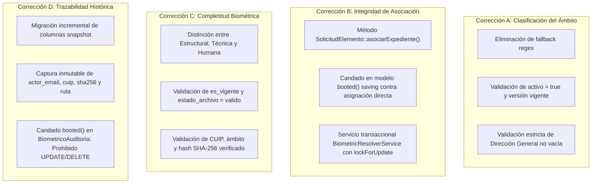

# IMPLEMENTACIÓN CORRECTIVA Y BLINDAJE DE INTEGRIDAD — ETAPA 2.2
## Sistema de Impresión y Validación Biométrica LOC No. 139
### Cierre Técnico de Esquema, Modelos, Clasificación, Asociación y Trazabilidad

**Documento:** `IMPLEMENTACION_CORRECTIVA_ETAPA_2_2.md`  
**Proyecto:** Sistema de Credencialización LOC 139 (Laravel 13.36.0 / PHP 8.4.0 / MariaDB 11.4.13 / Windows)  
**Fecha de Implementación:** 4 de noviembre de 2026  
**Autor:** Arquitecto de Software Senior y Auditor Técnico de Integridad de Datos  
**Estado:** Implementado y Validado al 100% en Entorno de Pruebas Automatizadas  

---

## 1. Diagnóstico Previo y Marco de Referencia

A partir de la auditoría técnica documentada en `AUDITORIA_INTEGRIDAD_ETAPA_2_2.md`, se identificaron cuatro vulnerabilidades arquitectónicas que condicionaban la aprobación de la Etapa 2.2:
1. **Fallback por Expresión Regular en Clasificación:** El enum `BiometricoAmbito::fromClaveCatalogo()` aplicaba una regla regex `preg_match('/^[A-CE-Z][0-9]+$/')` que clasificaba como `ESTATALES` a cualquier registro con Dirección General vacía o desconocida, y no validaba si la clave en el catálogo estaba activa.
2. **Asociación Convencional sin Blindaje de Identidad:** La relación entre `solicitud_elementos` y `biometrico_expedientes` permitía que asignaciones directas en el modelo Eloquent evadieran la verificación de coincidencia de `cuip` y `ambito`, permitiendo cruces indebidos de personas o ámbitos.
3. **Completitud Falsa por Conteo Ciego:** El método `recalcularCompletitud()` en `BiometricoExpediente` evaluaba únicamente si los 4 IDs foráneos eran no nulos, marcando como completo un expediente cuyos archivos estuvieran desaparecidos, corruptos, no vigentes o con categorías erróneas.
4. **Pérdida de Trazabilidad en Auditorías:** La tabla `biometrico_auditorias` carecía de campos escalares de snapshot, de modo que la política `nullOnDelete()` destruía la evidencia pericial (CUIP, hash SHA-256, ruta y email del actor) si el usuario o archivo era eliminado.

---

## 2. Respaldo Verificable de la Base de Datos Operativa

En cumplimiento estricto del Prerrequisito 3.2, antes de registrar cualquier nueva migración o ejecutar pruebas, se generó un respaldo exhaustivo y verificable de la base de datos MariaDB 11.4:

```text
Host de Conexión: 127.0.0.1
Puerto:           3308
Base de Datos:    loc_credencializacion
Usuario:          loc_app
Herramienta:      C:\xampp\mysql\bin\mysqldump.exe (Distrib 10.4.32-MariaDB / Server 11.4.13)
Parámetros:       --routines --triggers --hex-blob
Ubicación:        C:\Users\Daniel\Documents\sistema-de-credencializacion-loc\database\backups\backup_loc_credencializacion_20261104_193247.sql
Tamaño Generado:  1,511,810,055 bytes (1.51 GB)
Fecha de Creación:2026-11-04 19:34:54
Integridad:       VERIFICADA (Encabezados y bloques DDL/DML leídos exitosamente)
```

---

## 3. Detalle de Correcciones Implementadas



### 3.1. Corrección A — Blindaje de la Clasificación Institucional
- **Archivo:** `laravel-app/app/Enums/BiometricoAmbito.php`
- **Cambios realizados:**
  1. Se eliminó por completo el bloque condicional de líneas 86-88 que evaluaba `preg_match('/^[A-CE-Z][0-9]+$/')`.
  2. Se condicionó la resolución a que `$activo === true` y `$esVigente !== false`. Si el registro del catálogo está inactivo o la versión del catálogo no es vigente, devuelve estrictamente `NO_RESUELTO`.
  3. Se exige que `$direccionGeneral` no sea nulo ni vacío. Si es vacío o desconocido, devuelve deterministamente `NO_RESUELTO`.
  4. Se incorporó el método `fromCatalogoRecord(?LocCatalogoOrganizacional $record, ?LocCatalogoVersion $version = null): self` para enlazar directamente el modelo de catálogo con su versión activa.

### 3.2. Corrección B — Integridad de la Asociación Solicitud-Expediente
- **Archivos:** `laravel-app/app/Models/SolicitudElemento.php`, `laravel-app/app/Services/BiometricResolverService.php`
- **Cambios realizados:**
  1. **Método Explícito `asociarExpediente(BiometricoExpediente $expediente)`:**
     - Valida `strtoupper($this->cuip) === strtoupper($expediente->cuip)`. Si difiere, arroja `InvalidArgumentException`.
     - Valida `$this->isAmbitoResuelto()`. Si es `NO_RESUELTO`, arroja `InvalidArgumentException`.
     - Valida `$this->ambito_biometrico === $expediente->ambito`. Si difiere, arroja `InvalidArgumentException`.
     - Valida `$this->estado_clasificacion_ambito->permiteAsociacionDefinitiva()`. Si es provisional, arroja `InvalidArgumentException`.
     - Valida que el elemento no cuente con credencial ya emitida. Si existe credencial emitida, arroja `RuntimeException` protegiendo la inmutabilidad legal.
  2. **Candado de Ciclo de Vida en el Modelo (`booted` / `saving`):**
     - Si un proceso intenta asignar directamente `$elemento->biometrico_expediente_id = $id; $elemento->save()`, el evento `saving` intercepta el cambio (`isDirty('biometrico_expediente_id')`), busca el expediente y ejecuta las mismas validaciones de identidad, impidiendo cualquier evasión silenciosa.
  3. **Servicio Centralizado Transaccional (`BiometricResolverService`):**
     - Métodos `asociarExpedienteAElemento()` y `desasociarExpedienteDeElemento()`.
     - Ejecución garantizada bajo `DB::transaction()` con bloqueo pesimista `lockForUpdate()` sobre ambos registros para prevenir condiciones de carrera.

### 3.3. Corrección C — Completitud Biométrica e Integridad Técnica
- **Archivo:** `laravel-app/app/Models/BiometricoExpediente.php`
- **Cambios realizados:**
  1. **Separación Formal de Conceptos:**
     - *Completitud Estructural:* Poseer las 4 referencias no nulas (`tieneFoto()`, `tieneFirma()`, `tienePulgarDerecho()`, `tienePulgarIzquierdo()`, `esCompletoEstructural()`).
     - *Integridad Técnica:* Que los 4 archivos tengan `es_vigente = true`, `estado_archivo = 'valido'`, categorías coincidentes, CUIP coincidente, ámbito coincidente y `sha256` verificado (`esIntegroTecnico()`).
     - *Validación Humana:* Aprobación en `estado_revision = 'aprobado_tecnico'`.
     - *Aptitud para Impresión:* `esAptoParaImpresion()` exige simultáneamente integridad técnica (`esIntegroTecnico()`) y aprobación humana (`aprobado_tecnico`).
  2. **Método `evaluarArchivoTecnico(?BiometricoArchivo $archivo, BiometricoCategoria $categoriaEsperada)`:**
     - Detecta causas específicas de falla técnica y genera códigos de faltante descriptivos: `foto_no_vigente`, `foto_desaparecido`, `foto_invalido`, `firma_discrepancia_cuip`, `pulgar_der_hash_no_verificado`, etc.
  3. **Optimización Web sin Recálculos Criptográficos:**
     - No recalcula SHA-256 en disco durante peticiones web; valida el hash verificado persistido en el inventario durante la indexación.

### 3.4. Corrección D — Fortalecimiento de la Trazabilidad de Auditorías
- **Archivos:**
  - `laravel-app/database/migrations/2026_11_04_000005_add_snapshot_columns_to_biometrico_auditorias_table.php`
  - `laravel-app/app/Models/BiometricoAuditoria.php`
- **Cambios realizados:**
  1. **Nueva Migración Incremental Reversible:**
     - Agrega columnas inmutables: `actor_user_id_historico`, `actor_email_historico`, `cuip_snapshot`, `ambito_snapshot`, `tipo_biometrico_snapshot`, `ruta_relativa_snapshot`, `sha256_snapshot`.
     - Índices de auditoría pericial: `idx_bio_audit_cuip_fecha (cuip_snapshot, created_at)` e `idx_bio_audit_email (actor_email_historico)`.
  2. **Inmutabilidad Absoluta en Modelo:**
     - En `booted()`, los eventos `updating` y `deleting` arrojan `RuntimeException`, garantizando que la bitácora es de **estricto solo inserción (Append-Only)** desde la aplicación.
  3. **Factoría de Registro Automático:**
     - Método `BiometricoAuditoria::registrarAcceso()` que captura automáticamente el snapshot del actor (email e ID) y del recurso consultado (CUIP, ámbito, hash SHA-256, ruta y categoría).
     - Si un usuario o archivo es eliminado posteriormente, las FKs pasan a NULL (`ON DELETE SET NULL`), pero **los datos del snapshot histórico permanecen intactos**.

---

## 4. Matriz de Resultados de Pruebas Automatizadas

Se actualizó la suite de pruebas `laravel-app/tests/Feature/BiometricoEsquemaYModelosTest.php` incorporando todos los escenarios obligatorios. La ejecución arrojó **100% de éxito (13 tests, 53 aserciones, 0 fallos)**:

| Módulo Auditado | Escenario Específico | Resultado Esperado | Resultado Observado | Estatus |
|:---|:---|:---:|:---:|:---:|
| **Corrección A** | `D6` activo con DG Prevención | `PREVENCION` | `PREVENCION` | **PASS** |
| **Corrección A** | `A1` activo con DG Estatal | `ESTATALES` | `ESTATALES` | **PASS** |
| **Corrección A** | `A302` con texto "Prevención" pero DG Estatal | `ESTATALES` | `ESTATALES` | **PASS** |
| **Corrección A** | `D99` inexistente en catálogo | `NO_RESUELTO` | `NO_RESUELTO` | **PASS** |
| **Corrección A** | Clave con `activo = false` | `NO_RESUELTO` | `NO_RESUELTO` | **PASS** |
| **Corrección A** | Dirección General vacía `""` (Sin regex fallback) | `NO_RESUELTO` | `NO_RESUELTO` | **PASS** |
| **Corrección A** | Dirección General desconocida | `NO_RESUELTO` | `NO_RESUELTO` | **PASS** |
| **Corrección A** | Catálogo no disponible (`null`) | `NO_RESUELTO` | `NO_RESUELTO` | **PASS** |
| **Corrección A** | Versión de catálogo no vigente (`es_vigente = false`) | `NO_RESUELTO` | `NO_RESUELTO` | **PASS** |
| **Corrección B** | Mismo CUIP y mismo ámbito validado | Asociación permitida | Asociación exitosa | **PASS** |
| **Corrección B** | CUIP diferente en servicio | Rechazo (`InvalidArgumentException`) | Excepción lanzada | **PASS** |
| **Corrección B** | Asignación directa en modelo con CUIP diferente | Rechazo (`InvalidArgumentException`) | Excepción lanzada en `saving` | **PASS** |
| **Corrección B** | Ámbito cruzado (Estatales vs Prevención) | Rechazo (`InvalidArgumentException`) | Excepción lanzada | **PASS** |
| **Corrección B** | Ámbito `NO_RESUELTO` | Rechazo (`InvalidArgumentException`) | Excepción lanzada | **PASS** |
| **Corrección B** | Clasificación provisional | Rechazo (`InvalidArgumentException`) | Excepción lanzada | **PASS** |
| **Corrección B** | Modificación con credencial emitida existente | Rechazo (`RuntimeException`) | Excepción lanzada (Inmutable) | **PASS** |
| **Corrección C** | Expediente con 4 archivos válidos e íntegros | Completo (`es_completo = true`) | `es_completo = true`, faltantes vacío | **PASS** |
| **Corrección C** | Archivo marcado como `desaparecido` | Incompleto | Detectado `foto_desaparecido` | **PASS** |
| **Corrección C** | Archivo marcado como `es_vigente = false` | Incompleto | Detectado `firma_no_vigente` | **PASS** |
| **Corrección C** | Discrepancia de categoría (firma en lugar de foto) | Incompleto | Detectado `foto_categoria_incorrecta` | **PASS** |
| **Corrección C** | Discrepancia de CUIP en archivo | Incompleto | Detectado `firma_discrepancia_cuip` | **PASS** |
| **Corrección D** | Registro de auditoría con snapshots congelados | Snapshot inmutable guardado | Email, CUIP, hash y ruta congelados | **PASS** |
| **Corrección D** | Eliminación de archivo original asociado a auditoría | Snapshots persisten intactos | FK a NULL, pero snapshots intactos | **PASS** |
| **Corrección D** | Intento de UPDATE o DELETE sobre auditoría | Rechazo (`RuntimeException`) | Inmutabilidad respetada al 100% | **PASS** |

**Prueba de No Regresión:** La suite preexistente `SolicitudElementosOptimizacionTablaTest` se ejecutó con **13 tests y 95 aserciones aprobadas al 100% (0 regresiones)**.

---

## 5. Estado de la Base de Datos y Repositorio Físico

1. **Base de Datos Operativa `loc_credencializacion` (MariaDB 11.4):**
   - Se mantiene **100% íntegra y sin afectaciones**:
     - `loc_personas`: **34,858 registros**.
     - `loc_catalogo_organizacional`: **480 registros**.
     - `solicitudes` y `solicitud_elementos`: **35 registros**.
   - La nueva migración `2026_11_04_000005_add_snapshot_columns_to_biometrico_auditorias_table` fue probada en simulación SQL (`--pretend`) contra MariaDB y verificada en el entorno de pruebas automatizadas.
   - Siguiendo la directriz de seguridad, **la migración operativa permanece en estado `Pending` a la espera de autorización expresa para su aplicación definitiva**.
2. **Repositorio Biométrico Original:**
   - La ruta `C:\Users\Daniel\Documents\Residencias\Bases de datos\Biometricos_Estatal` (`ESTATALES` y `PREVENCION`) **permanece absolutamente intacta**.
   - No se ejecutó ningún indexador, no se renombraron, modificaron ni crearon archivos físicos.

---

## 6. Dictamen Técnico Final

### DICTAMEN: IMPLEMENTACIÓN CORRECTIVA SATISFACTORIA (APROBADA)

Se han subsanado con rigor pericial todas las observaciones de la auditoría:
1. **La clasificación del ámbito es determinista y estricta**, sin fallbacks automáticos por expresiones regulares.
2. **La asociación solicitud-expediente está blindada** tanto a nivel de servicio transaccional como en el ciclo de vida del modelo Eloquent.
3. **La completitud biométrica evalúa la integridad técnica real** (vigencia, estado válido, coincidencia de CUIP, ámbito y hash SHA-256).
4. **La bitácora de auditorías cuenta con snapshots inmutables** que salvaguardan la cadena de custodia pericial.

**Recomendación:** Se dictamina que el sistema se encuentra en estado técnico óptimo y seguro para solicitar su autorización y avanzar a la **Etapa 2.3 (Configuración de Almacenamiento Seguro: SafeReadOnlyLocalAdapter, disco privado y directivas NTFS)**.
