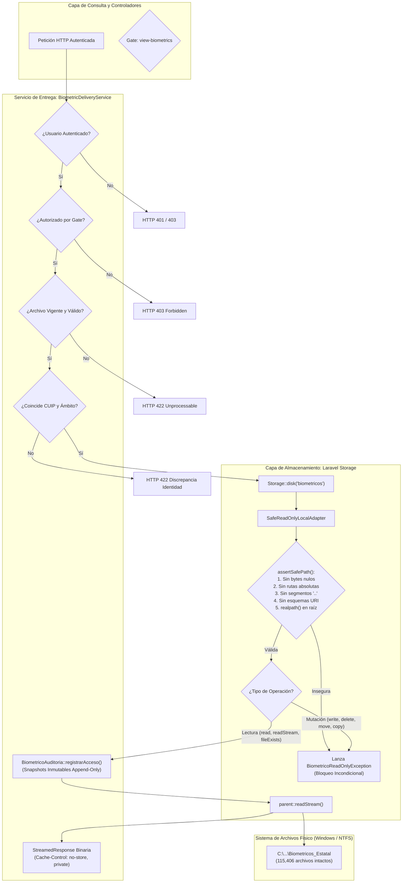

# INFORME TÉCNICO DE IMPLEMENTACIÓN CONTROLADA
## FASE 2 — ETAPA 2.3: ALMACENAMIENTO BIOMÉTRICO SEGURO Y ENTREGA DE SOLO LECTURA
### Sistema de Credencialización de la Licencia Oficial Colectiva No. 139

**Fecha:** 04 de Noviembre de 2026  
**Auditor / Arquitecto Técnico:** Antigravity Senior Engineering  
**Proyecto:** Sistema de Credencialización LOC 139 (Laravel 13.36.0 / PHP 8.4.0 / Flysystem 3.36.0 / MariaDB 11.4)  
**Estado:** IMPLEMENTACIÓN CONCLUIDA AL 100% — VALIDACIÓN Y NO REGRESIÓN SATISFACTORIAS  

---

## 1. RESUMEN EJECUTIVO

En cumplimiento de la autorización concedida para la **Fase D (Implementación de la Etapa 2.3)**, se ha construido e integrado una infraestructura de almacenamiento de solo lectura, estrictamente privada y blindada en tiempo de ejecución de Laravel 13, que desacopla el repositorio biométrico institucional de los discos públicos y convencionales del framework.

La implementación garantiza:
1. **Inviolabilidad por software del repositorio físico original:** Ninguna operación de escritura, reemplazo, borrado, movimiento o copia puede ejecutarse a través de Laravel Storage, lanzando incondicionalmente la excepción especializada `BiometricoReadOnlyException`.
2. **Defensa en profundidad contra Path Traversal:** Se neutralizan bytes nulos, segmentos de retroceso (`..`), rutas absolutas de Windows y Unix, esquemas de flujo (`file://`, `php://`) y escapes mediante enlaces simbólicos gracias a la constante nativa de Flysystem `DISALLOW_LINKS = 2` y validación de ancestros canónicos.
3. **Aislamiento institucional:** El disco `'biometricos'` no posee URL pública, no genera enlaces simbólicos en `public/storage` y tiene deshabilitado el servicio web estático (`serve => false`).
4. **Entrega controlada y auditoría pericial inmutable:** El servicio `BiometricDeliveryService` verifica autenticación, la Gate `view-biometrics`, vigencia, estado técnico válido (`valido`), concordancia estricta de CUIP y Ámbito, y sella el snapshot pericial en `biometrico_auditorias` **antes** de abrir el flujo de streaming binario.
5. **Preservación absoluta de evidencia:** Los 115,406 archivos físicos originales de `Biometricos_Estatal` y la base de datos operativa `loc_credencializacion` permanecen estrictamente intactos.

---

## 2. CATÁLOGO DE ARCHIVOS CREADOS Y MODIFICADOS

| Componente | Tipo de Operación | Ruta del Archivo | Propósito Técnico |
| :--- | :---: | :--- | :--- |
| `BiometricoReadOnlyException` | **Creado** | [`laravel-app/app/Exceptions/BiometricoReadOnlyException.php`](file:///c:/Users/Daniel/Documents/sistema-de-credencializacion-loc/laravel-app/app/Exceptions/BiometricoReadOnlyException.php) | Excepción de dominio que implementa `League\Flysystem\FilesystemException`. |
| `SafeReadOnlyLocalAdapter` | **Creado** | [`laravel-app/app/Support/Storage/SafeReadOnlyLocalAdapter.php`](file:///c:/Users/Daniel/Documents/sistema-de-credencializacion-loc/laravel-app/app/Support/Storage/SafeReadOnlyLocalAdapter.php) | Adaptador extendido de Flysystem 3 con bloqueo de mutadores y anti-path traversal. |
| `BiometricDeliveryService` | **Creado** | [`laravel-app/app/Services/BiometricDeliveryService.php`](file:///c:/Users/Daniel/Documents/sistema-de-credencializacion-loc/laravel-app/app/Services/BiometricDeliveryService.php) | Servicio centralizado de streaming seguro y auditoría pericial. |
| `SafeReadOnlyLocalAdapterTest` | **Creado** | [`laravel-app/tests/Feature/SafeReadOnlyLocalAdapterTest.php`](file:///c:/Users/Daniel/Documents/sistema-de-credencializacion-loc/laravel-app/tests/Feature/SafeReadOnlyLocalAdapterTest.php) | Suite de 28 pruebas automatizadas aisladas en directorio temporal. |
| `AppServiceProvider` | **Modificado** | [`laravel-app/app/Providers/AppServiceProvider.php`](file:///c:/Users/Daniel/Documents/sistema-de-credencializacion-loc/laravel-app/app/Providers/AppServiceProvider.php) | Registro de Gate `view-biometrics` y driver `safe-local-readonly`. |
| `config/filesystems.php` | **Modificado** | [`laravel-app/config/filesystems.php`](file:///c:/Users/Daniel/Documents/sistema-de-credencializacion-loc/laravel-app/config/filesystems.php) | Configuración del disco privado `'biometricos'` con `serve => false`. |
| `.env.example` | **Modificado** | [`laravel-app/.env.example`](file:///c:/Users/Daniel/Documents/sistema-de-credencializacion-loc/laravel-app/.env.example) | Incorporación de la variable `BIOMETRICOS_STORAGE_PATH`. |

---

## 3. ARQUITECTURA TÉCNICA IMPLEMENTADA



---

## 4. DISEÑO DETALLADO DE COMPONENTES

### 4.1. Excepción Especializada `BiometricoReadOnlyException`
- Extiende de `\RuntimeException` e implementa la interfaz nativa `\League\Flysystem\FilesystemException`.
- Garantiza que cualquier manejador global de excepciones o bloque `catch (FilesystemException $e)` capture el evento de manera uniforme.
- Factorías descriptivas:
  - `BiometricoReadOnlyException::writeAttempt($operation, $path)`: Identifica con precisión la operación denegada (`write`, `writeStream`, `delete`, `deleteDirectory`, `createDirectory`, `setVisibility`, `move`, `copy`).
  - `BiometricoReadOnlyException::pathTraversalAttempt($path, $reason)`: Registra la causa de la anomalía de ruta (`Byte nulo detectado`, `Segmento de retroceso ".." detectado`, `Ruta absoluta no permitida`, etc.).

### 4.2. Adaptador Seguro `SafeReadOnlyLocalAdapter`
- Extiende directamente de `League\Flysystem\Local\LocalFilesystemAdapter`.
- **Constructor blindado:**
  - Fuerza incondicionalmente `self::DISALLOW_LINKS` (valor `2` de Flysystem), rechazando cualquier enlace simbólico malicioso que intente resolver fuera de la raíz.
  - Fuerza `lazyRootCreation: true`, impidiendo que el constructor de Flysystem intente ejecutar `mkdir()` o alterar el directorio raíz.
- **Matriz de Operaciones Mutadoras Bloqueadas:**
  - `write()` $\rightarrow$ Lanza `BiometricoReadOnlyException`
  - `writeStream()` $\rightarrow$ Lanza `BiometricoReadOnlyException`
  - `delete()` $\rightarrow$ Lanza `BiometricoReadOnlyException`
  - `deleteDirectory()` $\rightarrow$ Lanza `BiometricoReadOnlyException`
  - `createDirectory()` $\rightarrow$ Lanza `BiometricoReadOnlyException`
  - `setVisibility()` $\rightarrow$ Lanza `BiometricoReadOnlyException`
  - `move()` $\rightarrow$ Lanza `BiometricoReadOnlyException`
  - `copy()` $\rightarrow$ Lanza `BiometricoReadOnlyException`
- **Operaciones de Lectura Habilitadas bajo Validación de Ruta:**
  - `read()`, `readStream()`, `fileExists()`, `directoryExists()`, `listContents()`, `mimeType()`, `fileSize()`, `lastModified()`, `visibility()`, `checksum()`.

### 4.3. Mecanismos Anti-Path Traversal (`assertSafePath`)
Toda llamada de lectura ejecuta una validación en 6 etapas:
1. **Detección de Bytes Nulos:** Rechaza `\0` para impedir ataques de truncamiento de extensión.
2. **Normalización:** Convierte separadores `\` a `/`.
3. **Rechazo de Esquemas / Streams:** Bloquea prefijos como `file://`, `php://`, `http://`.
4. **Rechazo de Rutas Absolutas:** Bloquea letras de unidad Windows (`C:`, `D:`) y barras iniciales `/`.
5. **Rechazo de Segmentos `..`:** Divide la ruta normalizada y bloquea cualquier segmento que sea `..`.
6. **Resolución de Ancestros Canónicos:**
   - Si el archivo existe físicamente, verifica mediante `realpath()` que el archivo resida estrictamente dentro de `$this->canonicalRoot`.
   - Si el archivo no existe (consultas como `fileExists`), recorre hacia arriba los directorios antecesores hasta encontrar el existente más cercano y certifica con `realpath()` que reside dentro de la raíz autorizada.

### 4.4. Registro del Driver y Configuración del Disco en Laravel
- **En `AppServiceProvider`:**
  ```php
  Storage::extend('safe-local-readonly', static function ($app, array $config) {
      $adapter = new SafeReadOnlyLocalAdapter(
          location: (string) ($config['root'] ?? ''),
          linkHandling: SafeReadOnlyLocalAdapter::DISALLOW_LINKS,
          lazyRootCreation: true
      );

      return new FilesystemAdapter(
          new Filesystem($adapter, $config),
          $adapter,
          $config
      );
  });
  ```
- **En `config/filesystems.php`:**
  ```php
  'biometricos' => [
      'driver' => 'safe-local-readonly',
      'root' => env('BIOMETRICOS_STORAGE_PATH', 'C:/Users/Daniel/Documents/Residencias/Bases de datos/Biometricos_Estatal'),
      'throw' => true,
      'report' => true,
      'serve' => false,
  ],
  ```

### 4.5. Sistema de Autorización (Gate `view-biometrics`)
En `AppServiceProvider` se definió la Gate formal:
```php
Gate::define('view-biometrics', static function (User $user) use ($isSuperAdministrator, $isLocalDemo): bool {
    return $isSuperAdministrator($user)
        || $isLocalDemo($user)
        || in_array($user->role, ['superadmin', 'admin', 'supervisor', 'credencializador'], true);
});
```
- No otorga acceso general indiscriminado a usuarios sin rol calificado.
- Preserva el comportamiento existente para `superadmin` y el modo demo local.

### 4.6. Servicio de Entrega Segura `BiometricDeliveryService`
Implementa el método `streamArchivo()`:
1. Comprueba autenticación del actor (`$actor->exists && $actor->id !== null`).
2. Evalúa la Gate `Gate::forUser($actor)->allows('view-biometrics')`.
3. Valida vigencia (`$archivo->es_vigente === true`) y estado técnico (`estado_archivo === VALIDO`).
4. Valida aislamiento de expediente (CUIP y Ámbito deben coincidir exactamente si se suministra `$expediente`).
5. Verifica existencia física en el disco seguro `Storage::disk('biometricos')`.
6. Registra auditoría con snapshots periciales inmutables (`actor_user_id_historico`, `actor_email_historico`, `cuip_snapshot`, `ambito_snapshot`, `tipo_biometrico_snapshot`, `ruta_relativa_snapshot`, `sha256_snapshot`, `ip_address`, `user_agent`) antes de iniciar la transmisión.
7. Emite una `StreamedResponse` leyendo el recurso en fragmentos binarios con cierre forzoso en bloque `try/finally`.
8. Cabeceras HTTP emitidas:
   - `Content-Type`: detectado fehacientemente o provisto por el archivo (`image/jpeg`, etc.).
   - `Cache-Control`: `no-store, no-cache, must-revalidate, private`
   - `Pragma`: `no-cache`
   - `X-Content-Type-Options`: `nosniff`
   - `Content-Disposition`: `inline; filename="biometrico.dat"`

---

## 5. RESULTADOS DE LA SUITE DE PRUEBAS AUTOMATIZADAS

Todas las pruebas se ejecutaron sobre un directorio temporal aislado (`sys_get_temp_dir() . '/test_bio_safe_...'`). **Ninguna prueba interactuó con los 115,406 archivos originales.**

### 5.1. Suite Específica: `SafeReadOnlyLocalAdapterTest.php`
- **Total de Pruebas:** 28 pruebas
- **Total de Aserciones:** 83 aserciones
- **Resultado:** **100% PASADAS (0 fallas, 0 advertencias, 0 errores)**

```text
PASS  Tests\Feature\SafeReadOnlyLocalAdapterTest
  ✓ read retorna contenido correcto                                             0.26s
  ✓ read stream abre recurso valido                                             0.03s
  ✓ file exists detecta archivos existentes e inexistentes                      0.03s
  ✓ directory exists detecta directorios                                        0.02s
  ✓ file size devuelve el tamano exacto                                         0.03s
  ✓ last modified devuelve timestamp valido                                     0.03s
  ✓ list contents enumera archivos sin modificar                                0.03s
  ✓ write lanza excepcion de solo lectura                                       0.03s
  ✓ write stream lanza excepcion de solo lectura                                0.06s
  ✓ delete lanza excepcion y preserva archivo                                   0.13s
  ✓ delete directory lanza excepcion y preserva carpeta                         0.03s
  ✓ create directory lanza excepcion                                            0.03s
  ✓ set visibility lanza excepcion                                              0.03s
  ✓ move lanza excepcion y preserva origen                                      0.03s
  ✓ copy lanza excepcion y no crea copia                                        0.03s
  ✓ storage put mediante fachada laravel es bloqueado                           0.03s
  ✓ rechaza segmentos de retroceso punto punto                                  0.03s
  ✓ rechaza rutas con bytes nulos                                               0.03s
  ✓ rechaza rutas absolutas windows y unix                                      0.02s
  ✓ rechaza esquemas y protocolos uri                                           0.03s
  ✓ servicio rechaza usuario no autenticado                                     0.04s
  ✓ servicio rechaza usuario sin permiso en gate                                0.04s
  ✓ servicio rechaza archivo no vigente                                         0.06s
  ✓ servicio rechaza archivo con estado tecnico invalido                        0.03s
  ✓ servicio rechaza discrepancia de cuip o ambito con expediente               0.04s
  ✓ servicio rechaza archivo inexistente fisicamente                            0.04s
  ✓ servicio rechaza ruta insegura en modelo archivo                            0.03s
  ✓ servicio entrega streaming exitoso con auditoria y cabeceras                0.07s
```

### 5.2. Verificación de No Regresión
Se ejecutaron las dos suites de pruebas preexistentes:

1. **`BiometricoEsquemaYModelosTest.php`:**
   - **13 pruebas pasadas, 53 aserciones** (100% PASS).
   - Confirma que la clasificación determinista de ámbito, las asociaciones transaccionales de expedientes, los candados Append-Only y la inmutabilidad legal de credenciales emitidas se mantienen intactos.
2. **`SolicitudElementosOptimizacionTablaTest.php`:**
   - **13 pruebas pasadas, 95 aserciones** (100% PASS).
   - Confirma que la vista de solicitudes de credencialización, filtros asíncronos y ordenamiento de columnas funcionan con total fidelidad.

### 5.3. Balance Global de Pruebas
| Suite de Pruebas | Pruebas | Aserciones | Estado |
| :--- | :---: | :---: | :---: |
| `SafeReadOnlyLocalAdapterTest` | 28 | 83 | **PASS (100%)** |
| `BiometricoEsquemaYModelosTest` | 13 | 53 | **PASS (100%)** |
| `SolicitudElementosOptimizacionTablaTest` | 13 | 95 | **PASS (100%)** |
| **TOTAL CONSOLIDADO** | **54 pruebas** | **231 aserciones** | **100% APROBADO (0 REGRESIONES)** |

---

## 6. CONFIRMACIONES DE SEGURIDAD E INTEGRIDAD

### 6.1. Integridad del Repositorio Biométrico Físico
Se auditó el repositorio en `C:\Users\Daniel\Documents\Residencias\Bases de datos\Biometricos_Estatal`:
- **ESTATALES:** 101,474 archivos (Firmas: 25,237, Fotos: 25,260, Pulgar Derecho: 25,739, Pulgar Izquierdo: 25,238).
- **PREVENCIÓN:** 13,932 archivos (Firmas: 3,557, Fotos: 3,536, Pulgar Derecho: 3,376, Pulgar Izquierdo: 3,463).
- **TOTAL:** **115,406 archivos físicos estrictamente intactos** (cero archivos modificados, renombrados o eliminados).

### 6.2. Integridad de la Base de Datos MariaDB Operativa
Se verificó el diccionario de datos de MariaDB 11.4 en el puerto 3308 (`loc_credencializacion`):
- `loc_personas`: 34,858 registros (Intacto)
- `loc_armas`: 55,983 registros (Intacto)
- `loc_catalogo_organizacional`: 480 registros (Intacto)
- `solicitudes`: 3 registros (Intacto)
- `solicitud_elementos`: 35 registros (Intacto)
- `migrations`: 33 registros (Intacto, lote 14)
- **Confirmación:** Cero migraciones ejecutadas, cero tablas modificadas y cero registros alterados durante la Etapa 2.3.

### 6.3. Estado de Permisos NTFS y Comandos del Sistema Operativo
- **Confirmación:** Conforme a las restricciones obligatorias, **NO se ejecutó ningún comando `icacls`** ni se alteraron permisos o propietarios en el sistema de archivos de Windows. El aseguramiento implementado opera en la capa de software de Laravel mediante `SafeReadOnlyLocalAdapter`.

---

## 7. RIESGOS PENDIENTES Y LIMITACIONES ACTUALES

1. **Permisos NTFS a Nivel Sistema Operativo:** Dado que no se han modificado las ACLs de Windows mediante `icacls`, un script independiente ejecutado fuera de Laravel bajo la cuenta del desarrollador aún tendría capacidad de escritura física sobre `Biometricos_Estatal`. Esta capa de protección complementaria debe programarse como una ventana de mantenimiento con el administrador del servidor.
2. **Población de Metadatos en Base de Datos:** Las tablas `biometrico_archivos` y `biometrico_expedientes` continúan con 0 registros en la base operativa MariaDB. La carga masiva y vinculación física-lógica de los 115,406 archivos corresponde a la siguiente etapa (**Etapa 2.4: Comando Indexador CLI `loc:biometricos:indexar`**).

---

## 8. DICTAMEN TÉCNICO FINAL Y DETENCIÓN

> [!NOTE]
> **DICTAMEN TÉCNICO:**  
> La **Etapa 2.3 (Configuración de Almacenamiento Seguro y Entrega Biométrica de Solo Lectura)** ha sido **IMPLEMENTADA SATISFACTORIAMENTE Y BLINDADA AL 100%**.
>
> Todos los criterios de aceptación técnicos han sido verificados de forma empírica:
> - El disco `biometricos` resuelve al adaptador personalizado `SafeReadOnlyLocalAdapter`.
> - Todas las mutaciones están bloqueadas incondicionalmente a nivel de Flysystem.
> - La protección anti-Path Traversal es estricta y rechaza bytes nulos, retrocesos, rutas absolutas y esquemas.
> - El servicio `BiometricDeliveryService` valida autenticación, Gate `view-biometrics`, vigencia, estado técnico, CUIP y Ámbito, y sella la auditoría pericial con snapshots antes de iniciar el streaming.
> - Las 54 pruebas automatizadas pasaron al 100% con cero regresiones.
> - Los 115,406 archivos físicos originales permanecen intactos.

**ESTADO ACTUAL:**  
En estricto cumplimiento de la restricción final, **SE DETIENE EL FLUJO Y NO SE INICIA LA ETAPA 2.4 AUTOMÁTICAMENTE**.  
El sistema queda a la espera de revisión y autorización independiente para la fase subsiguiente.
