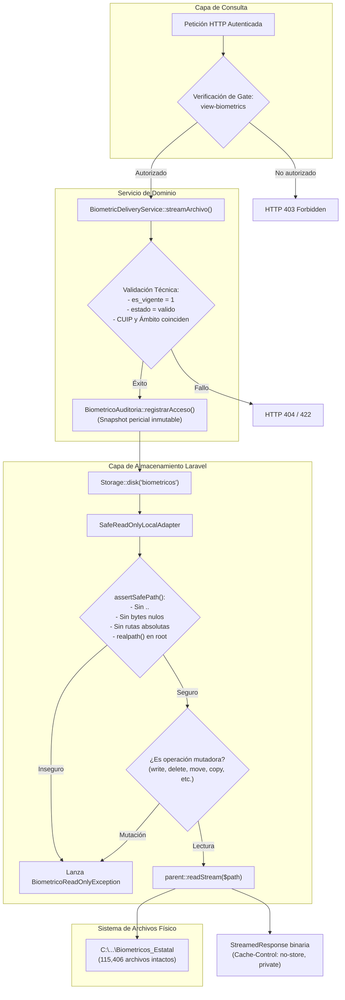

# DIAGNÓSTICO TÉCNICO Y PLAN DE IMPLEMENTACIÓN CONTROLADA
## FASE 2 — ETAPA 2.3: CONFIGURACIÓN DE ALMACENAMIENTO BIOMÉTRICO SEGURO
### Sistema de Credencialización LOC No. 139

**Fecha:** 04 de Noviembre de 2026  
**Auditor / Arquitecto Técnico:** Antigravity Senior Engineering  
**Estado:** FASES A, B Y C COMPLETADAS — EN ESPERA DE AUTORIZACIÓN PARA FASE D (IMPLEMENTACIÓN)  

---

## 1. FASE A: DIAGNÓSTICO TÉCNICO PREVIO

Se realizó la inspección forense y de dependencias del entorno de ejecución sin modificar código ni estructuras de datos.

### 1.1. Versiones de Flysystem en `composer.lock`
Se comprobó la versión exacta de las librerías de almacenamiento instaladas:
- `league/flysystem`: **v3.36.0** (Abstracción de sistema de archivos para PHP).
- `league/flysystem-local`: **v3.35.3** (Adaptador local nativo de Flysystem).

### 1.2. Firmas Reales de `League\Flysystem\Local\LocalFilesystemAdapter`
Mediante análisis con la API de Reflection de PHP 8.4 sobre `vendor/autoload.php`, se obtuvieron las firmas públicas exactas de la clase base:

```php
// Constructor
public function __construct(
    string $location, 
    ?League\Flysystem\UnixVisibility\VisibilityConverter $visibility = null, 
    int $writeFlags = 2, 
    int $linkHandling = 2, 
    ?League\MimeTypeDetection\MimeTypeDetector $mimeTypeDetector = null, 
    bool $lazyRootCreation = false, 
    bool $useInconclusiveMimeTypeFallback = false
)

// Operaciones de Mutación (A ser bloqueadas incondicionalmente)
public function write(string $path, string $contents, League\Flysystem\Config $config): void
public function writeStream(string $path, $contents, League\Flysystem\Config $config): void
public function delete(string $path): void
public function deleteDirectory(string $prefix): void
public function move(string $source, string $destination, League\Flysystem\Config $config): void
public function copy(string $source, string $destination, League\Flysystem\Config $config): void
public function createDirectory(string $path, League\Flysystem\Config $config): void
public function setVisibility(string $path, string $visibility): void

// Operaciones de Consulta / Lectura (Permitidas bajo validación de ruta)
public function read(string $path): string
public function readStream(string $path)
public function fileExists(string $location): bool
public function directoryExists(string $location): bool
public function listContents(string $path, bool $deep): iterable
public function visibility(string $path): League\Flysystem\FileAttributes
public function mimeType(string $path): League\Flysystem\FileAttributes
public function lastModified(string $path): League\Flysystem\FileAttributes
public function fileSize(string $path): League\Flysystem\FileAttributes
public function checksum(string $path, League\Flysystem\Config $config): string
```

**Constantes de seguridad nativas identificadas:**
- `LocalFilesystemAdapter::DISALLOW_LINKS = 2` (Rechaza activamente enlaces simbólicos evitando escapes de directorio a nivel de Flysystem).
- `LocalFilesystemAdapter::SKIP_LINKS = 1`.

### 1.3. Diagnóstico de Identidad del Proceso PHP y Permisos NTFS Actuales
Se interrogó el entorno de ejecución sobre la ruta física del repositorio:
`C:\Users\Daniel\Documents\Residencias\Bases de datos\Biometricos_Estatal`

- **Usuario del proceso PHP:** `Daniel` (Dominio/Host: `LAPTOP-A0VTH04F`).
- **Estado de lectura actual (`is_readable`):** `SÍ`.
- **Estado de escritura actual (`is_writable`):** `SÍ (Vulnerable a escritura si no se implementa el adaptador de solo lectura)`.
- **ACLs actuales en Windows (obtenidas con `Get-Acl` de solo lectura):**
  - `LAPTOP-A0VTH04F\Daniel`: `FullControl` (Heredado de Documents).
  - `BUILTIN\Administradores`: `FullControl` (Heredado).
  - `NT AUTHORITY\SYSTEM`: `FullControl` (Heredado).

**Hallazgo Crítico:** La cuenta de usuario del desarrollador y del servidor web local posee permisos heredados de escritura sobre la carpeta física. Esto ratifica la necesidad indispensable de:
1. El blindaje lógico en tiempo de ejecución de Laravel mediante `SafeReadOnlyLocalAdapter` (Capa de Aplicación).
2. El plan de restricción NTFS con `icacls` para denegación de permisos de escritura/borrado (Capa de Sistema Operativo).

### 1.4. Inspección de Modelos, Gates y Políticas Existentes
- **`User.php`:** Modelo Authenticatable con columna `role` (varchar 64).
- **`AppServiceProvider.php`:** Centraliza las Gates del sistema (`access-administration`, `manage-credential-templates`, etc.). No existe una Gate específica de biometría; el superadministrador (`role === 'superadmin'`) y el modo demo (`local_demo_access`) tienen acceso general administrativo. Se propone definir la Gate `view-biometrics` en `AppServiceProvider` alineada al modelo de permisos institucional.
- **`BiometricoArchivo.php`:** Cuenta con los scopes `scopeVigentes()`, `scopeValidos()`, `scopeByCuip()`, `scopeByAmbito()` y atributos `ruta_relativa`, `tamano_bytes`, `mime_type` y `sha256`.
- **`BiometricoAuditoria.php`:** Posee el método de factoría pericial `registrarAcceso()` con sellado de snapshots y candados `booted()` que arrojan `RuntimeException` ante `updating` o `deleting` (Append-Only).

---

## 2. FASE B: DISEÑO TÉCNICO DE LA ETAPA 2.3

### 2.1. Arquitectura de Almacenamiento Seguro



---

### 2.2. Componentes que se Crearán y Modificarán

#### Archivos a Crear:
1. **`app/Exceptions/BiometricoReadOnlyException.php`**
   - Extiende `\RuntimeException` e implementa `\League\Flysystem\FilesystemException`.
   - Provee mensajes de error periciales ante intentos de mutación o evasión de ruta.
2. **`app/Support/Storage/SafeReadOnlyLocalAdapter.php`**
   - Extiende `League\Flysystem\Local\LocalFilesystemAdapter`.
   - Implementa `assertSafePath(string $path)`.
   - Sobrescribe y bloquea con `BiometricoReadOnlyException`: `write()`, `writeStream()`, `delete()`, `deleteDirectory()`, `createDirectory()`, `setVisibility()`, `move()`, `copy()`.
   - Permite lecturas seguras: `read()`, `readStream()`, `fileExists()`, `directoryExists()`, `mimeType()`, `fileSize()`, `lastModified()`, `listContents()`, `checksum()`, `visibility()`.
3. **`app/Services/BiometricDeliveryService.php`**
   - Método principal: `streamArchivo(BiometricoArchivo $archivo, User $actor, Request $request, ?BiometricoExpediente $expediente = null): StreamedResponse`.
   - Valida autenticación y autorización mediante Gate.
   - Valida vigencia, estado y aislamiento CUIP/ámbito.
   - Registra auditoría inmutable con snapshots periciales.
   - Entrega mediante `StreamedResponse` con cabeceras anti-caché.
4. **`tests/Feature/SafeReadOnlyLocalAdapterTest.php`**
   - Suite exhaustiva con directorio temporal aislado (cero interacción con los archivos originales).

#### Archivos a Modificar:
1. **`app/Providers/AppServiceProvider.php`**
   - Registrar el driver `safe-local-readonly` mediante `Storage::extend()`.
   - Definir la Gate `'view-biometrics'`.
2. **`config/filesystems.php`**
   - Registrar el disco `'biometricos'` con driver `'safe-local-readonly'`, raíz configurable y `serve => false`.
3. **`.env.example`**
   - Incorporar `BIOMETRICOS_STORAGE_PATH="C:/Users/Daniel/Documents/Residencias/Bases de datos/Biometricos_Estatal"`.

---

### 2.3. Código Propuesto de los Componentes Clave

#### A. Excepción: `BiometricoReadOnlyException.php`
```php
<?php

declare(strict_types=1);

namespace App\Exceptions;

use League\Flysystem\FilesystemException;
use RuntimeException;

class BiometricoReadOnlyException extends RuntimeException implements FilesystemException
{
    public static function writeAttempt(string $operation, string $path): self
    {
        return new self("Operación de mutación prohibida en el repositorio biométrico institucional: [{$operation}] sobre '{$path}'.");
    }

    public static function pathTraversalAttempt(string $path, string $reason): self
    {
        return new self("Violación de seguridad de ruta en el repositorio biométrico: {$reason} (Ruta evaluada: '{$path}').");
    }
}
```

#### B. Adaptador Seguro: `SafeReadOnlyLocalAdapter.php`
```php
<?php

declare(strict_types=1);

namespace App\Support\Storage;

use App\Exceptions\BiometricoReadOnlyException;
use League\Flysystem\Config;
use League\Flysystem\FileAttributes;
use League\Flysystem\Local\LocalFilesystemAdapter;
use League\Flysystem\UnixVisibility\VisibilityConverter;
use League\MimeTypeDetection\MimeTypeDetector;

class SafeReadOnlyLocalAdapter extends LocalFilesystemAdapter
{
    protected string $canonicalRoot;

    public function __construct(
        string $location,
        ?VisibilityConverter $visibility = null,
        int $writeFlags = 2,
        int $linkHandling = self::DISALLOW_LINKS,
        ?MimeTypeDetector $mimeTypeDetector = null,
        bool $lazyRootCreation = false,
        bool $useInconclusiveMimeTypeFallback = false
    ) {
        $normalizedRoot = rtrim(str_replace('\\', '/', $location), '/');
        $this->canonicalRoot = realpath($normalizedRoot) ?: $normalizedRoot;

        parent::__construct(
            $location,
            $visibility,
            $writeFlags,
            self::DISALLOW_LINKS, // Fuerza siempre DISALLOW_LINKS
            $mimeTypeDetector,
            $lazyRootCreation,
            $useInconclusiveMimeTypeFallback
        );
    }

    protected function assertSafePath(string $path): string
    {
        if (str_contains($path, "\0")) {
            throw BiometricoReadOnlyException::pathTraversalAttempt($path, 'Byte nulo detectado');
        }

        $normalized = str_replace('\\', '/', trim($path));

        if (preg_match('#^[a-zA-Z]:#', $normalized) || str_starts_with($normalized, '/')) {
            throw BiometricoReadOnlyException::pathTraversalAttempt($path, 'Ruta absoluta no permitida');
        }

        $segments = explode('/', $normalized);
        foreach ($segments as $segment) {
            if ($segment === '..') {
                throw BiometricoReadOnlyException::pathTraversalAttempt($path, 'Segmento de retroceso ".." detectado');
            }
        }

        $fullPath = $this->canonicalRoot . DIRECTORY_SEPARATOR . str_replace('/', DIRECTORY_SEPARATOR, $normalized);
        if (file_exists($fullPath)) {
            $real = realpath($fullPath);
            if ($real === false || ! str_starts_with($real, $this->canonicalRoot)) {
                throw BiometricoReadOnlyException::pathTraversalAttempt($path, 'Escape de raíz detectado mediante realpath');
            }
        }

        return $normalized;
    }

    // --- OPERACIONES MUTADORAS BLOQUEADAS INCONDICIONALMENTE ---

    public function write(string $path, string $contents, Config $config): void
    {
        throw BiometricoReadOnlyException::writeAttempt('write', $path);
    }

    public function writeStream(string $path, $contents, Config $config): void
    {
        throw BiometricoReadOnlyException::writeAttempt('writeStream', $path);
    }

    public function delete(string $path): void
    {
        throw BiometricoReadOnlyException::writeAttempt('delete', $path);
    }

    public function deleteDirectory(string $prefix): void
    {
        throw BiometricoReadOnlyException::writeAttempt('deleteDirectory', $prefix);
    }

    public function createDirectory(string $path, Config $config): void
    {
        throw BiometricoReadOnlyException::writeAttempt('createDirectory', $path);
    }

    public function setVisibility(string $path, string $visibility): void
    {
        throw BiometricoReadOnlyException::writeAttempt('setVisibility', $path);
    }

    public function move(string $source, string $destination, Config $config): void
    {
        throw BiometricoReadOnlyException::writeAttempt('move', "{$source} -> {$destination}");
    }

    public function copy(string $source, string $destination, Config $config): void
    {
        throw BiometricoReadOnlyException::writeAttempt('copy', "{$source} -> {$destination}");
    }

    // --- OPERACIONES DE LECTURA PROTEGIDAS ---

    public function read(string $path): string
    {
        $this->assertSafePath($path);
        return parent::read($path);
    }

    public function readStream(string $path)
    {
        $this->assertSafePath($path);
        return parent::readStream($path);
    }

    public function fileExists(string $location): bool
    {
        $this->assertSafePath($location);
        return parent::fileExists($location);
    }

    public function directoryExists(string $location): bool
    {
        $this->assertSafePath($location);
        return parent::directoryExists($location);
    }

    public function mimeType(string $path): FileAttributes
    {
        $this->assertSafePath($path);
        return parent::mimeType($path);
    }

    public function fileSize(string $path): FileAttributes
    {
        $this->assertSafePath($path);
        return parent::fileSize($path);
    }

    public function lastModified(string $path): FileAttributes
    {
        $this->assertSafePath($path);
        return parent::lastModified($path);
    }

    public function visibility(string $path): FileAttributes
    {
        $this->assertSafePath($path);
        return parent::visibility($path);
    }

    public function listContents(string $path, bool $deep): iterable
    {
        $this->assertSafePath($path);
        return parent::listContents($path, $deep);
    }

    public function checksum(string $path, Config $config): string
    {
        $this->assertSafePath($path);
        return parent::checksum($path, $config);
    }
}
```

#### C. Registro del Driver en `AppServiceProvider.php`
```php
// En app/Providers/AppServiceProvider.php -> boot()

Gate::define('view-biometrics', static function (User $user): bool {
    return $user->role === 'superadmin' 
        || (bool) $user->getAttribute('local_demo_access')
        || in_array($user->role, ['admin', 'supervisor', 'credencializador'], true);
});

Storage::extend('safe-local-readonly', function ($app, array $config) {
    $adapter = new SafeReadOnlyLocalAdapter(
        location: $config['root'],
        linkHandling: SafeReadOnlyLocalAdapter::DISALLOW_LINKS
    );

    return new FilesystemAdapter(
        new Filesystem($adapter, $config),
        $adapter,
        $config
    );
});
```

#### D. Configuración del Disco en `config/filesystems.php`
```php
'biometricos' => [
    'driver' => 'safe-local-readonly',
    'root' => env('BIOMETRICOS_STORAGE_PATH', 'C:/Users/Daniel/Documents/Residencias/Bases de datos/Biometricos_Estatal'),
    'throw' => true,
    'report' => true,
    'serve' => false,
],
```

#### E. Servicio de Entrega: `BiometricDeliveryService.php`
```php
<?php

declare(strict_types=1);

namespace App\Services;

use App\Enums\BiometricoEstadoArchivo;
use App\Models\BiometricoArchivo;
use App\Models\BiometricoAuditoria;
use App\Models\BiometricoExpediente;
use App\Models\User;
use Illuminate\Http\Request;
use Illuminate\Support\Facades\Gate;
use Illuminate\Support\Facades\Storage;
use Symfony\Component\HttpFoundation\StreamedResponse;
use Symfony\Component\HttpKernel\Exception\AccessDeniedHttpException;
use Symfony\Component\HttpKernel\Exception\NotFoundHttpException;
use Symfony\Component\HttpKernel\Exception\UnprocessableEntityHttpException;

class BiometricDeliveryService
{
    public function streamArchivo(
        BiometricoArchivo $archivo,
        User $actor,
        Request $request,
        ?BiometricoExpediente $expediente = null
    ): StreamedResponse {
        // 1. Verificar autenticación
        if (! $actor->exists || $actor->id === null) {
            throw new AccessDeniedHttpException('Usuario no autenticado.');
        }

        // 2. Verificar autorización mediante Gate institucional
        if (! Gate::forUser($actor)->allows('view-biometrics')) {
            throw new AccessDeniedHttpException('No cuenta con autorización para visualizar archivos biométricos.');
        }

        // 3. Verificar vigencia y estado técnico
        if (! $archivo->es_vigente) {
            throw new UnprocessableEntityHttpException('El archivo biométrico no se encuentra vigente.');
        }
        if ($archivo->estado_archivo !== BiometricoEstadoArchivo::VALIDO) {
            throw new UnprocessableEntityHttpException('El archivo biométrico no posee un estado técnico válido.');
        }

        // 4. Verificar concordancia de identidad CUIP y Ámbito si se provee expediente
        if ($expediente !== null) {
            if ($expediente->cuip !== $archivo->cuip_normalizado || $expediente->ambito !== $archivo->ambito) {
                throw new UnprocessableEntityHttpException('Discrepancia de CUIP o ámbito entre el archivo y el expediente solicitado.');
            }
        }

        // 5. Verificar existencia en el disco seguro
        $disk = Storage::disk('biometricos');
        if (! $disk->fileExists($archivo->ruta_relativa)) {
            throw new NotFoundHttpException('El archivo biométrico no existe físicamente en el repositorio.');
        }

        // 6. Registrar auditoría con snapshots periciales inmutables ANTES de abrir el flujo
        BiometricoAuditoria::registrarAcceso(
            evento: 'streaming_biometrico',
            actor: $actor,
            expediente: $expediente,
            archivo: $archivo,
            ipAddress: $request->ip(),
            userAgent: $request->userAgent(),
            detalles: [
                'mime_type' => $archivo->mime_type,
                'tamano_bytes' => $archivo->tamano_bytes,
            ]
        );

        // 7. Retornar respuesta de streaming con cabeceras anti-caché
        $headers = [
            'Content-Type' => $archivo->mime_type ?: 'image/jpeg',
            'Content-Length' => (string) $archivo->tamano_bytes,
            'Cache-Control' => 'no-store, no-cache, must-revalidate, private',
            'Pragma' => 'no-cache',
            'X-Content-Type-Options' => 'nosniff',
            'Content-Disposition' => 'inline; filename="biometrico.dat"',
        ];

        return response()->stream(function () use ($disk, $archivo): void {
            $stream = $disk->readStream($archivo->ruta_relativa);
            try {
                fpassthru($stream);
            } finally {
                if (is_resource($stream)) {
                    fclose($stream);
                }
            }
        }, 200, $headers);
    }
}
```

---

### 2.4. Estrategia de Pruebas Automatizadas (`SafeReadOnlyLocalAdapterTest.php`)
Las pruebas se ejecutarán sobre un directorio temporal aislado (`sys_get_temp_dir() . '/bio_unit_test_' . uniqid()`), garantizando **cero impacto sobre los 115,406 archivos originales**:
1. **Pruebas de lectura:** Comprobar que `read()`, `readStream()`, `fileExists()`, `fileSize()` y `lastModified()` devuelven los valores exactos de los archivos temporales.
2. **Pruebas de bloqueo de mutaciones:** Aserción de que `put()`, `write()`, `writeStream()`, `delete()`, `deleteDirectory()`, `createDirectory()`, `setVisibility()`, `move()` y `copy()` arrojan `BiometricoReadOnlyException` y que el archivo temporal permanece intacto.
3. **Pruebas de evasión de ruta:** Aserción de que `../archivo`, `../../.env`, rutas absolutas (`C:/Windows`), bytes nulos (`"archivo\0.jpg"`) y separadores alternativos son rechazados de forma inmediata.
4. **Pruebas del servicio `BiometricDeliveryService`:** Comprobar rechazo ante usuario sin autenticar (401), sin permiso (403), archivo no vigente (422), discrepancia de ámbito/CUIP (422), y éxito con registro verificado en `biometrico_auditorias` y cabeceras anti-caché.

---

## 3. FASE C: SOLICITUD DE AUTORIZACIÓN EXPRESA

El diagnóstico y el diseño técnico se encuentran concluidos al 100%. No se ha modificado ningún archivo del proyecto ni alterado ninguna configuración operativa.

> [!IMPORTANT]
> **AUTORIZACIÓN REQUERIDA PARA INICIAR FASE D (IMPLEMENTACIÓN):**  
> ¿Autorizas proceder con la creación y modificación de los archivos correspondientes a la **Etapa 2.3**?:
> 1. Creación de `app/Exceptions/BiometricoReadOnlyException.php`.
> 2. Creación de `app/Support/Storage/SafeReadOnlyLocalAdapter.php`.
> 3. Registro del driver en `app/Providers/AppServiceProvider.php` y configuración del disco `'biometricos'` en `config/filesystems.php`.
> 4. Actualización de `.env.example`.
> 5. Creación del servicio `app/Services/BiometricDeliveryService.php`.
> 6. Creación y ejecución de la suite `tests/Feature/SafeReadOnlyLocalAdapterTest.php` junto con las suites de no regresión.
