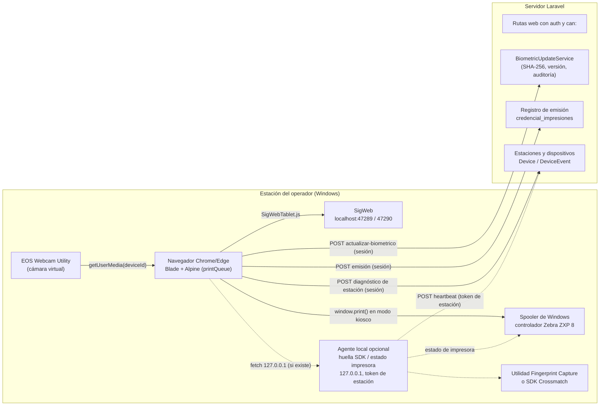

# Auditoría de periféricos: captura biométrica e impresión de credenciales

Fecha: 2026-11-11 · Alcance: solo lectura sobre `laravel-app/` · Evidencia en formato `ruta:línea`.

## 1. Resumen ejecutivo

Hoy no hay ningún puente con el hardware. La captura y la impresión dependen únicamente de lo que el navegador ofrece:
- `getUserMedia` sin elegir dispositivo.
- Un `fetch` a SigWeb contra recursos que no coinciden con la biblioteca oficial.
- `window.print()` desde una página marcada como "demostración".
- Carga manual de huellas.

Ninguna impresión queda registrada: nada asigna `estado_emision = 'emitida'`, así que tampoco se activa el candado de inmutabilidad biométrica.

El riesgo más urgente no es de hardware sino de seguridad, y se verificó con una petición sin sesión:
- `GET /impresion/plantilla/imprimir?elemento_id=` responde 200 y devuelve el CUIP real.
- El detalle `/credencializacion/solicitudes/{id}` también responde sin sesión y expone CUIPs.

Otra limitación de fondo: si el sistema se sirve por HTTP a las estaciones (servidor Linux según `deployment/`), la cámara por navegador no funciona, porque `getUserMedia` exige HTTPS o `localhost`.

**Arquitectura recomendada:** solución mixta.
- El navegador habla directamente con los servicios que el fabricante ya instala: cámara vía EOS Webcam Utility y firma vía SigWeb.
- La impresión se resuelve con Chrome/Edge en modo de impresión silenciosa, más el registro de emisión en Laravel.
- Un único agente local ligero se construye **solo si** la huella lo exige (SDK o carpeta de exportación) o si se necesita el estado real de la impresora. Si se construye, debe concentrar huella, impresora y reporte de estado, autenticado por estación.

## 2. Estado actual por dispositivo

| Dispositivo | Implementado | Faltante | Riesgo |
|---|---|---|---|
| Zebra ZXP Series 8 | Vista 54 × 86 mm con `@page` (`credential-template-print.blade.php:140-142`); botón `window.print()` (`:14`); offsets X/Y guardados como configuración del dispositivo (`config/devices.php:27-38`) | Impresión silenciosa, selección de impresora, aplicación de offsets, registro de emisión y reimpresión, código de barras real, autenticación de la ruta | **Alto** |
| Canon EOS Rebel T6 | `getUserMedia` 1280×720 con `facingMode:'user'` (`impresion.blade.php:1637-1644`); recorte 3:4 a 600×800 (`:1681-1699`); carga manual de archivo de hasta 2 MB (`:2006`) | Selección de dispositivo (`deviceId`), recorte derivado de la plantilla, redimensionado en el cliente, contexto seguro (HTTPS) | Medio |
| Topaz SigLite LCD 1x5 | Sondeo y captura por `fetch` a `http://localhost:47289` (`impresion.blade.php:1909`, `:1933-1940`); lienzo táctil alterno; carga de archivo | Uso de `SigWebTablet.js`, trazo en vivo, aceptar/limpiar, conteo de puntos, liberar el pad, HTTPS (47290) | Medio |
| Crossmatch Verifier 300 LC 2.0 | Carga manual de BMP/PNG/JPG (`impresion.blade.php:1201`; `UpdateBiometricoElementoRequest.php:45-46`) | Cualquier integración con el lector o su utilidad; control de calidad de huella | **Alto** (es el eslabón más manual) |

## 3. Verificación de hipótesis

| # | Estado | Evidencia | Explicación |
|---|---|---|---|
| 1 | **Confirmada** | `impresion.blade.php:1637`, `:1909`, `:1933`; `credential-template-print.blade.php:14`; `DeviceDiagnostics.php:18-28`; `README.md:63` | No hay agente, extensión ni app de escritorio. No aparecen `qz`, `kiosk`, `enumerateDevices` ni `SigWebTablet` en `app/`, `resources/` o `config/`. El README declara que Laravel no accede al hardware. |
| 2 | **Confirmada** en el código. **Pendiente de verificar contra la versión instalada de SigWeb** si `/SigWeb/SignatureImage` existe | `impresion.blade.php:1933` (POST `TabletState/1`), `:1939` (espera fija de 1.5 s), `:1940` (`/SigWeb/SignatureImage`) | No hay `TabletState 0` en todo el archivo (solo aparece en `:1909` y `:1933`), así que el pad nunca se libera. Tampoco hay trazo en vivo, conteo de puntos, botones de limpiar/aceptar propios del pad, ni manejo de HTTPS o CORS. La URL está fija a `http://localhost:47289`. |
| 3 | **Confirmada** | `impresion.blade.php:1641` (`facingMode:'user'`, sin `deviceId`); `:1681-1682` (600×800 fijos); `config/devices.php:47` (`eos_utility_folder`) | Si la estación tiene una cámara web integrada, puede abrirse esa en lugar de la Canon. El recorte no lee el elemento `fotografia` de la plantilla. El método de conexión declarado (carpeta de EOS Utility) no corresponde con el implementado (`getUserMedia`). |
| 4 | **Confirmada** | `UpdateBiometricoElementoRequest.php:46` (`max:2048`); `impresion.blade.php:2006-2010` | Un JPG de 18 MP de la T6 pesa varios MB y se rechaza en el cliente antes de subir. No hay redimensionado. La captura por cámara sí cabe, porque se reduce a 600×800 en `:1699`. |
| 5 | **Confirmada** | `impresion.blade.php:1201`, `:2024`; `config/devices.php:67`; `UpdateBiometricoElementoRequest.php:80` | Solo hay carga manual. El motivo por defecto afirma "importada desde lector Crossmatch" sin comprobarlo. `vendor_export_folder` no tiene implementación. La única validación de calidad es un mínimo de 50×50 px. |
| 6 | **Confirmada** | `credential-template-print.blade.php:14`; no hay ninguna asignación de `'emitida'` en el código (solo lecturas en `PrintQueueController.php:71`, `:385`, `:636`; `SolicitudElementoPolicy.php:32`; `BiometricUpdateService.php:54`) | `validarBiometriaPorTarjeta` crea la credencial con `estado_emision='pendiente'` y `fecha_emision=null` (`PrintQueueController.php:349-351`). Por eso el contador `impresos` (`:71`) nunca sube y el candado de `updateBiometrics` nunca se activa. No hay endpoint de emisión ni de reimpresión. |
| 7 | **Parcial** | `PhaseFourPersistenceTest.php:114`, `:123` (`'emitido'`) contra `PrintQueueController.php:71` (`'emitida'`); `create_credenciales_emitidas_table.php:18` (`string`, sin enum) | La inconsistencia existe, pero está en `PhaseFourPersistenceTest`, no en `PrintQueueTest`. No hay enum ni constante que unifique los valores. |
| 8 | **Confirmada** | `config/devices.php:27-38`; los offsets solo aparecen en ese archivo y en pruebas (`DeviceManagementTest.php:38-39`, `:157-158`; `LocalDemoAccessTest.php:101-102`) | Ninguna vista los aplica. El catálogo no define campos de nombre de impresora, copias ni impresión a dos caras. |
| 9 | **Confirmada** | `credential-template-print.blade.php:98-119` | Son 22 `<rect>` fijos; solo el texto debajo (`:121`) muestra el valor. El código no es legible por un lector de código de barras. |
| 10 | **Confirmada (alto)** | `routes/web.php:96-98`, `:114-117`, `:126-128` fuera del grupo `auth` (`:100`); `CredentialTemplateController.php:319-341` | Prueba sin sesión: `/impresion/plantilla/imprimir?elemento_id=42` devolvió **200 con el CUIP**. `printPreview` carga persona, vigencias y armas de cualquier `elemento_id` sin verificar permiso, estado, folio ni que la solicitud esté enviada a impresión. `/impresion` y `/impresion/cola` también responden 200 sin sesión y listan tarjetas (número, oficio y área: `impresion.blade.php:9-12`). |
| 11 | **Confirmada** | `DeviceDiagnostics.php:18-28` (siempre `RESULT_UNAVAILABLE`); `create_devices_and_device_events_tables.php:18` (`location` como texto libre) | No existe entidad de estación ni endpoint para que una estación reporte su estado. `connection_status` (`:22`) nunca se actualiza desde hardware. |
| 12 | **Confirmada** | `credential-template-print.blade.php:14` (botón habilitado de inmediato), `:60-63` (`` a la ruta autenticada); `CredentialTemplateController.php:461-473` | No se espera a que terminen de cargar las imágenes. Sin sesión, la ruta de biométricos responde 302 (comprobado), así que la página "imprimible" pública sale sin foto, firma ni huellas. |

## 4. Hallazgos adicionales

| Severidad | Hallazgo | Evidencia |
|---|---|---|
| **Alta** | El detalle de solicitud es público y expone CUIP, nombres y armas de todos los elementos (200 sin sesión, comprobado) | `routes/web.php:80-81` (fuera del grupo `auth` de `:83`) |
| **Alta** | `validarBiometriaPorTarjeta` (que asigna folios) autoriza a cualquier usuario autenticado si el entorno es `local` o `testing`. Además, en la lista de roles incluye `local_demo` | `PrintQueueController.php:127-133` |
| Media | La policy concede permisos por rol en `testing`, saltándose los gates. Las pruebas no ejercen la autorización real | `SolicitudElementoPolicy.php:18-20`, `:36-38` |
| Media | `elementosPorTarjeta` no verifica rol: cualquier usuario autenticado obtiene nombres y CUIPs de la tarjeta | `PrintQueueController.php:46-58` |
| Media | La vista de impresión real se rotula como "demostración" ("solo demostración", "Imprimir demostración") aunque cargue datos reales | `credential-template-print.blade.php:3-6`, `:11`, `:14` |
| Media | El folio se consume al validar la biometría, no al imprimir. Si no se imprime, el folio queda reservado sin trazabilidad de emisión | `PrintQueueController.php:341-351` |
| Media | `fecha_emision` es `date`: no registra hora. Tampoco hay campos de impresora, estación ni número de impresión | `create_credenciales_emitidas_table.php:20` |
| Baja | Fuga de *object URL* al reabrir la vista previa de la firma (`createObjectURL` sin `revoke`) | `impresion.blade.php:1103` |
| Baja | El pad Topaz queda tomado (no hay `TabletState 0`). Si el usuario cierra la pestaña a media captura, el pad sigue activo | `impresion.blade.php:1933` (no hay contraparte) |
| Baja | El mensaje de error de `mimes` omite BMP aunque se acepta | `UpdateBiometricoElementoRequest.php:45`, `:98` |
| Baja | La ruta de edición de plantilla `/impresion/plantilla` es pública (200 sin sesión; las acciones de guardado sí exigen `can:`) | `routes/web.php:114-115` |
| Cobertura | No hay pruebas de: `printPreview` con `elemento_id` real, acceso sin sesión a impresión o al detalle, emisión y reimpresión, ni aplicación de offsets. Las pruebas de dispositivos solo cubren CRUD y el diagnóstico "no disponible" | `CredentialTemplateEditorTest.php:163-169` (solo demostración); `DeviceManagementTest.php:227` |

**Lo que sí está bien y conviene reutilizar:**
- `BiometricUpdateService` versiona el archivo con SHA-256, bloquea las filas y registra auditoría (`BiometricUpdateService.php:46-49`, `:122`, `:218-230`).
- La validación de *magic bytes* del archivo (`UpdateBiometricoElementoRequest.php:61-77`).
- La entrega de biométricos con auditoría de acceso y `Cache-Control: no-store` (`BiometricDeliveryService.php:128`, `:160`).
- El modelo `Device`/`DeviceEvent` con `connection_status` y bitácora (`Device.php:11-27`, `DeviceEvent.php:14-24`).

## 5. Evaluación de alternativas

Criterios: **C** confiabilidad · **S** seguridad · **I** instalación y actualización por estación · **M** mantenimiento · **E** encaje con Blade/Alpine · **H** funcionamiento por HTTP/HTTPS · **T** dependencia de terceros o licencias · **R** capacidad de reportar estado a Administración de dispositivos.

### 5.1 Impresora Zebra ZXP Series 8

| Opción | C | S | I | M | E | H | T | R |
|---|---|---|---|---|---|---|---|---|
| `window.print()` con diálogo (actual) | Baja: el operador elige impresora, márgenes y escala en cada impresión | = | Nula | Nulo | Total | Ambos | Ninguna | No |
| **Chrome/Edge con `--kiosk-printing`** y la Zebra como impresora predeterminada | Alta si la estación tiene una sola impresora de tarjetas | No abre puertos | Un acceso directo o política por estación | Bajo | Total: se conserva `window.print()` | Ambos | Ninguna | No (solo la confirmación del operador) |
| QZ Tray | Alta; imprime por nombre de impresora y lista impresoras | Abre un WebSocket local; requiere certificado firmado para no mostrar avisos | Instalador más el certificado | Medio | Buena: biblioteca JS | Ambos (wss) | **Licencia comercial** para impresión sin avisos | Parcial (lista impresoras, no el estado de la cinta) |
| Agente propio: spooler de Windows o Zebra Card SDK | Muy alta: estado de cinta y tarjeta, doble cara, codificación | Hay que diseñar la autenticación | Instalador y servicio | Alto | Media: API local | Ambos | El SDK de Zebra (verificar licencia) | **Sí, real** |
| App contenedora (Electron, Tauri, WebView2) | Alta (`silent` y `deviceName`, como en la referencia) | Superficie grande | Alto: se actualiza en cada estación | Alto: duplica el *shell* de la aplicación | Media: la app web pasa a vivir dentro de otra | Ambos | Runtime | Parcial |
| PDF en el servidor + impresión local | Media: la escala de un PDF en tarjetas suele introducir desplazamientos | = | Visor de PDF | Medio | Media | Ambos | Motor de PDF en el servidor | No |

**Recomendada: Chrome/Edge con `--kiosk-printing` + registro de emisión en Laravel**, con offsets aplicados en CSS.

Por qué encaja con el código:
- La vista ya tiene `@page 54mm 86mm` y la orientación validada (`credential-template-print.blade.php:140-142`).
- Mantiene `window.print()` y no exige software nuevo.
- El hueco real está en el servidor: no hay registro de emisión (hipótesis 6) y la ruta es pública (hipótesis 10).

**Pasar a un agente con Zebra Card SDK** solo si se necesita alguna de estas cosas:
- Estado de la cinta o de la tarjeta atascada.
- Impresión a doble cara con módulo de volteo.
- Más de una impresora de tarjetas por estación.

**Descartadas:**
- QZ Tray: licencia y certificados para lo mismo que logra el modo kiosco.
- Electron y similares: duplican la aplicación y el ciclo de actualización.
- PDF: añade un motor de PDF y otro punto de escalado.

**Límite a conocer:** `--kiosk-printing` no confirma que la tarjeta salió. La emisión se registra con una confirmación del operador ("impresa correctamente" o "falló → reimprimir con motivo").

### 5.2 Cámara Canon EOS Rebel T6

| Opción | C | S | I | M | E | H | T | R |
|---|---|---|---|---|---|---|---|---|
| **`getUserMedia` con `deviceId` + EOS Webcam Utility** | Alta: vista en vivo y recorte guiado | No abre puertos; la imagen va por el endpoint existente con SHA-256 | Solo instalar EOS Webcam Utility | Bajo | Total: ya existe en `impresion.blade.php:1629` | **Solo HTTPS o `localhost`** | Canon (verificar compatibilidad de la T6 y si la versión es gratuita) | Parcial: el navegador puede reportar si encontró el dispositivo |
| Vigilar la carpeta de EOS Utility | Media: sin vista en vivo y con posible confusión de archivos entre sesiones | Necesita agente o File System Access | Agente | Medio | Media | Ambos (con agente) | Ninguna | Sí, con agente |
| EDSDK vía agente | Muy alta: control de exposición y disparo | Hay que diseñar la autenticación | Alto | Alto (EDSDK cambia por modelo) | Media | Ambos | **Registro como desarrollador de Canon** | Sí |

**Recomendada: `getUserMedia` con selector de dispositivo persistido por estación y recorte derivado del elemento `fotografia` de la plantilla.**
- Ya está implementada casi por completo (`impresion.blade.php:1629-1717`).
- Solo faltan `enumerateDevices`/`deviceId`, el recorte desde la plantilla y el redimensionado de archivos manuales.
- **Requiere servir por HTTPS** (o abrir en `localhost`).
- EDSDK se descarta por costo y mantenimiento sin beneficio claro para una foto de credencial.

### 5.3 Pad Topaz SigLite LCD 1x5

| Opción | C | S | I | M | E | H | T | R |
|---|---|---|---|---|---|---|---|---|
| `fetch` manual (actual) | Baja: espera fija, recurso dudoso, el pad no se libera | = | — | — | — | Solo HTTP | — | No |
| **SigWeb con `SigWebTablet.js` oficial** | Alta: trazo en vivo, conteo de puntos, limpiar, aceptar | SigWeb ya escucha en local; no se agrega nada | Ninguna adicional (SigWeb ya está instalado) | Bajo | Total: un `<canvas>` y JS | Ambos: 47289 (HTTP) y 47290 (HTTPS, host `tablet.sigwebtablet.com`) | Topaz (gratuito con el pad; verificar términos) | Parcial: el navegador sondea SigWeb |
| SigPlus u otro SDK vía agente | Alta | Hay que diseñar la autenticación | Agente | Alto | Media | Ambos | Topaz | Sí |

**Recomendada: SigWeb directo con la biblioteca oficial**, servida desde `public/vendor/topaz/`.
- El fabricante ya resolvió el puente local; un agente propio repetiría lo que SigWeb ya hace.
- Flujo:
  1. `SetTabletState(1)` y dibujar el trazo en vivo en un `<canvas>`.
  2. Comprobar que el conteo de puntos sea mayor que 0 antes de aceptar.
  3. Obtener la imagen y enviarla por el endpoint existente.
  4. `SetTabletState(0)` siempre, también en `finally` y al cerrar el modal o la página.
- Hay que confirmar en la estación los nombres exactos de los recursos de la versión instalada de SigWeb y su comportamiento con el acceso a red local de Chrome (sección 8).

### 5.4 Lector Crossmatch Verifier 300 LC 2.0

| Opción | C | S | I | M | E | H | T | R |
|---|---|---|---|---|---|---|---|---|
| Carga manual (actual) | Baja: error humano y sin calidad | El archivo pasa por *magic bytes* y SHA-256 | Nula | Nulo | Total | Ambos | Ninguna | No |
| Capturar la ventana de "Fingerprint Capture" (referencia) | Media-baja: depende del título y tamaño de la ventana y de un detector propio; se rompe con actualizaciones | Captura de pantalla: la imagen es de pantalla, no del sensor | Agente o app | Alto | Media | Ambos | Ninguna | Parcial |
| Carpeta de exportación + **File System Access API** (navegador) | Media: depende de que la utilidad exporte de forma automática y consistente | Sin puertos; el usuario concede acceso a la carpeta una vez | Nula | Bajo | Buena: JS en `impresion.blade.php` | **Solo HTTPS**; solo Chromium | Ninguna | No |
| Carpeta de exportación + agente | Media-alta | Hay que diseñar la autenticación | Agente | Medio | Media | Ambos | Ninguna | Sí |
| **SDK del fabricante vía agente** | **Alta**: captura directa del sensor y puntaje de calidad (p. ej. NFIQ) | Hay que diseñar la autenticación; la imagen es del sensor | Agente y SDK | Alto | Media | Ambos | **SDK de HID/Crossmatch: verificar disponibilidad y licencia** | **Sí** |

**Recomendada en dos pasos:**
1. **Inmediato:** mantener la carga manual con correcciones: motivo veraz, mensaje de formatos, controles de dimensiones o resolución mínimas.
2. **Decisión pendiente:**
   - Si la utilidad del lector **exporta a carpeta**, empezar con File System Access (no instala nada).
   - Si se exige calidad o integridad de la captura, o no hay exportación, **SDK vía agente**.

La captura de ventana de la referencia se descarta como solución definitiva: la evidencia biométrica sería una captura de pantalla y la detección es frágil. Se conserva solo como plan de contingencia.

### 5.5 ¿Una sola pieza local o una solución mixta?

**Mixta.** Razones basadas en el código:
1. La interfaz de captura ya existe en Alpine (`impresion.blade.php:1629-2111`) y todo converge en un único endpoint con auditoría, SHA-256 y versionado (`BiometricUpdateService`). Un agente que suba por su cuenta duplicaría ese camino y perdería la sesión del usuario como responsable.
2. Dos de los cuatro fabricantes ya instalan un puente local: SigWeb para el pad y EOS Webcam Utility para la cámara.
3. Los huecos de impresión son del servidor (registro y autenticación), no de hardware.

Si la huella exige SDK o la impresora exige estado real, construir **un solo agente** para ambos, para no tener varios servicios por estación.

## 6. Arquitectura recomendada

### Contrato propuesto (Laravel)

| Método y ruta | Uso | Autorización |
|---|---|---|
| `POST /impresion/elementos/{elemento}/emision` | Body `{resultado: impresa\|fallida, estacion_id, impresora, motivo?}`. Registra el intento. Si el resultado es `impresa` y es la primera vez: `estado_emision='emitida'`, `fecha_emision`, `emitida_por_user_id` | `auth`, gate `print-credentials`, solicitud en `enviada_impresion`, `listo_impresion` y folio asignado |
| `POST /impresion/elementos/{elemento}/reimpresion` | Exige `motivo` (mínimo 10 caracteres). Crea un nuevo intento y no cambia el folio | Gate `reprint-credentials` |
| `GET /impresion/plantilla/imprimir` | Mover a `auth` + `viewPreview` + validaciones de estado; incluir los offsets de la estación | Igual que la emisión |
| `POST /estaciones/{estacion}/diagnostico` | El navegador reporta `{camara:{encontrada,label}, sigweb:{ok,version}, impresora:{confirmada}}` → `Device.connection_status` + `DeviceEvent` | `auth` + `test-devices` |
| `POST /api/estaciones/heartbeat` (solo si hay agente) | Body con el estado de los dispositivos del agente | `Authorization: Bearer <token de estación>` (hash en BD), limitado por frecuencia |

**API local del agente (solo si se construye):**
- Escucha únicamente en `127.0.0.1`.
- Exige el mismo token de estación en la cabecera.
- Permite CORS solo desde el origen de Laravel.
- Endpoints: `GET /estado`, `POST /huella/capturar` (devuelve la imagen y la calidad al navegador, que la sube por el endpoint existente) y `POST /impresora/estado`.

### Identidad de la estación

- Nueva tabla `estaciones`: `id`, `nombre`, `token_hash`, `ultimo_reporte_at`, `ultima_ip`.
- `devices.estacion_id` como FK nullable; `location` se conserva por compatibilidad.
- La estación se vincula desde Administración, que emite un token una sola vez. El navegador guarda el `estacion_id` vinculado en una cookie firmada; el agente guarda el token.
- Los offsets y el `deviceId` de cámara se leen de los `Device` vinculados a la estación.

### Qué se reutiliza

**Del repositorio:**
- El catálogo de `config/devices.php`, ampliado con `printer_name`, `duplex` y `camera_device_label`.
- `DeviceEvent` como bitácora.
- `connection_status` de `Device`.
- `BiometricUpdateService` y el endpoint `actualizar-biometrico` como único canal de ingreso.
- La entrega auditada de biométricos.

**De la implementación de referencia:**
- `deviceId` seleccionable.
- Recorte al marco de la plantilla y JPEG 0.92.
- Impresión de prueba "ARRIBA/DERECHA" para calibrar los offsets.
- Impresión silenciosa por nombre de impresora, que aquí se resuelve con el modo kiosco o con el agente.

## 7. Plan de implementación por fases

### Fase 0: correcciones inmediatas (independientes de la arquitectura)

| # | Tarea | Archivos | Pruebas |
|---|---|---|---|
| 0.1 | Proteger con `auth` las rutas `/impresion`, `/impresion/cola`, `/impresion/biometricos`, `/impresion/plantilla`, `/impresion/plantilla/imprimir`, `/credencializacion/solicitudes` y `/credencializacion/solicitudes/{id}`. En `printPreview` exigir `viewPreview`, solicitud `enviada_impresion`, `listo_impresion` y folio | `routes/web.php`, `CredentialTemplateController.php:295-353` | Invitado → redirige a login; usuario sin permiso → 403; elemento no listo → 409. Ajustar `CredentialTemplateEditorTest.php:163` |
| 0.2 | Eliminar el permiso automático por entorno en `validarBiometriaPorTarjeta` y en la policy; agregar control de rol a `elementosPorTarjeta` | `PrintQueueController.php:127-133`, `:46`; `SolicitudElementoPolicy.php:18`, `:36` | Pruebas con gates reales (pueden romper fixtures que hoy dependen del permiso automático) |
| 0.3 | Unificar los estados de emisión en un enum `EstadoEmision` (`pendiente`, `emitida`, `cancelada`) y corregir `PhaseFourPersistenceTest` | `app/Enums/`, `CredencialEmitida.php`, lecturas en `PrintQueueController`, `SolicitudElementoPolicy`, `BiometricUpdateService` | Prueba del cast |
| 0.4 | Registro de emisión y reimpresión: endpoint, tabla `credencial_impresiones` (usuario, estación, impresora, resultado, motivo, fecha y hora) y botones "Impresa correctamente / Falló" en la vista de impresión | Migración **aditiva**, controlador, `credential-template-print.blade.php` | Emisión activa el candado (`updateBiometrics` devuelve 403); el contador `impresos` sube; la reimpresión exige motivo |
| 0.5 | Código de barras real (Code 128) generado en el servidor como SVG | `credential-template-print.blade.php:94-122` y un generador | Decodificar el SVG en una prueba |
| 0.6 | Habilitar el botón de imprimir solo cuando todas las `` terminen de cargar (`img.decode()`); avisar si alguna falla | `credential-template-print.blade.php:14`, `:60-68` | Prueba en navegador (Playwright) |
| 0.7 | Quitar el rótulo "demostración" cuando el elemento es real | `credential-template-print.blade.php:3-14` | `assertDontSee` |
| 0.8 | Redimensionar en el cliente (canvas, lado mayor de unos 1600 px, JPEG 0.92) antes de subir fotos; corregir el mensaje de BMP y el motivo por defecto de huella | `impresion.blade.php:2002-2030`, `UpdateBiometricoElementoRequest.php:98` | Prueba manual con un JPG de la T6 |
| 0.9 | Liberar el *object URL* de `:1103` | `impresion.blade.php` | — |

### Fase 1: periféricos por navegador (requiere decidir HTTPS)

1. **HTTPS institucional** para el sitio. Es prerrequisito para la cámara y para File System Access; además evita contenido mixto con SigWeb en el puerto 47290.
2. **Cámara:**
   - Selector de `enumerateDevices()`, recordando el `deviceId` por estación.
   - Recorte con la relación de aspecto del elemento `fotografia` de la plantilla aprobada.
   - Detener los *tracks* también en `pagehide`.
3. **Topaz:**
   - Incorporar `SigWebTablet.js` en `public/vendor/topaz/`.
   - Implementar trazo en vivo, limpiar, aceptar con conteo de puntos y `SetTabletState(0)` en `finally`, `pagehide` y al cerrar el modal.
   - Elegir el puerto según el protocolo.
4. **Impresora:**
   - Guía de configuración de la estación (acceso directo de Chrome/Edge con `--kiosk-printing`, Zebra como predeterminada, perfil del controlador en CR-80 vertical).
   - Aplicar `offset_x_mm` y `offset_y_mm` con `transform: translate()` sobre `.credential-print-card`.
   - Página de calibración ARRIBA/DERECHA.
5. **Estaciones:** migración `estaciones` y `devices.estacion_id`, vinculación desde Administración, y `POST /estaciones/{id}/diagnostico` alimentado por el navegador (cámara encontrada, SigWeb disponible).

**Depende de:** la Fase 0.4 (la impresión ya registra emisión) y de la respuesta sobre HTTPS.

### Fase 2: huella (según la respuesta sobre exportación y SDK)

- **2a (sin instalación):** si la utilidad exporta a carpeta, File System Access con un *handle* persistente; la página detecta el archivo más reciente con fecha posterior al inicio de la captura y lo carga en el slot.
- **2b (agente):** servicio de Windows en `127.0.0.1` con el SDK del fabricante (captura y calidad), token de estación y `heartbeat`. Requiere sus propias pruebas de integración y un instalador.
- En ambos casos la imagen se sube por `actualizar-biometrico`, y conviene ampliar `motivo_cambio` o los metadatos con origen y calidad.

### Fase 3 (opcional): impresora vía agente

Solo si hace falta estado de la cinta, doble cara o varias impresoras: ampliar el agente de la Fase 2b con el Zebra Card SDK y reportar el estado al `heartbeat`.

## 8. Preguntas abiertas

1. ¿Cuántas estaciones de captura e impresión habrá, y cada una tendrá su propia Zebra?
2. ¿El sistema se servirá a las estaciones por **HTTP o HTTPS**, y con qué nombre o IP? Por HTTP desde otra máquina, `getUserMedia` y File System Access no funcionan.
3. ¿Se puede instalar software adicional en las estaciones (un agente propio, EOS Webcam Utility) y configurar accesos directos o políticas de Chrome/Edge?
4. ¿La utilidad "Fingerprint Capture" del Verifier 300 LC **exporta a una carpeta automáticamente**, con qué nombres de archivo, formato y resolución (DPI)?
5. ¿Se tiene acceso al **SDK de HID/Crossmatch** para este lector (licencia y versión)? ¿Se exige un puntaje mínimo de calidad (NFIQ)?
6. ¿La ZXP Series 8 tiene **módulo de volteo** (impresión a doble cara)? ¿Anverso y reverso se imprimen en una sola tarjeta y en una sola pasada?
7. ¿Qué valor debe codificar el código de barras (CUIP, folio u otro) y con qué simbología?
8. ¿EOS Webcam Utility es compatible con la Rebel T6 en la versión disponible, y la versión gratuita basta (resolución, marca de agua)?
9. ¿Qué versión de SigWeb hay instalada? ¿Responde `tablet.sigwebtablet.com:47290` con certificado válido? ¿Muestra Chrome/Edge el aviso de acceso a red local al llamarla desde el dominio del sistema?
10. ¿El folio debe asignarse al validar la biometría (como hoy) o al confirmar la impresión? ¿Cómo se trata un folio asignado que nunca se imprimió?
11. ¿Quién puede reimprimir, y la reimpresión requiere aprobación de un segundo usuario?
